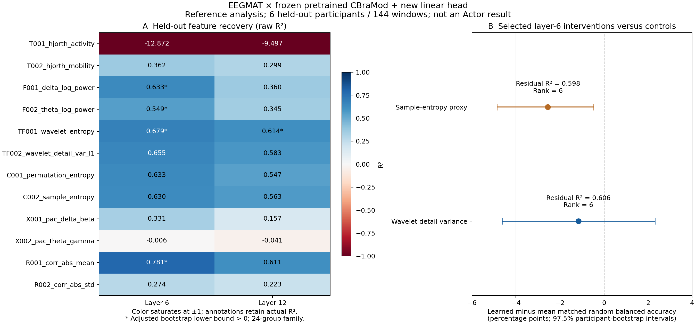

# 真实 EEG 科学结果：参考分析

**结论：预训练表征保留了可读出的信号属性；当前干预不足以证明某个属性被干净消除，也不足以建立生理因果关系。** 本页是 Builder 的参考分析，不能作为受测 Agent 的成绩。Actor 结果另列案例报告。

## 数据、模型与推断范围

使用新下载的公开 EEGMAT 与官方预训练 CBraMod 权重，在冻结骨干上仅用训练被试拟合一个新的线性分类头。任务是心理算术与背景条件分类，不是抑郁、临床压力或诊断。训练/验证/测试分别为 24/6/6 名被试、576/144/144 个窗口；同一被试不会跨集合。每个窗口为 20 通道、5 秒、200 Hz。两个分析层为第 6、12 层，面板含 12 类、62 列特征。

所有拟合使用训练集，选择使用验证集，参考协议和拟合文件在最终测试前封存。测试仅执行一次。既有实验室 dataset 未参与本次读取或复制。此研究属于新的模型适配分析，不是 BrainPEC 下游任务的匹配复现。

冻结头的验证 balanced accuracy 为 **67.36%**；测试 balanced accuracy 为 **56.94%**，AUROC 为 **0.6439**。弱跨被试分类能力、仅 6 名测试被试及采集条件混杂，均限制后续机制解释。

## Q1：哪些属性可以恢复

24 个特征—层组合中，20 个测试 R² 点估计为正。按 24 项家族调整后的被试 bootstrap 区间，有 5 项下界高于零：第 6 层 delta 对数功率、theta 对数功率、小波熵、平均绝对通道相关，以及第 12 层小波熵。

| 特征 | 第 6 层 R² | 第 12 层 R² |
|---|---:|---:|
| Hjorth activity | -12.872 | -9.497 |
| Hjorth mobility | 0.362 | 0.299 |
| Delta 对数功率 | 0.633 | 0.360 |
| Theta 对数功率 | 0.549 | 0.345 |
| 小波熵 | 0.679 | 0.614 |
| 小波细节方差 | 0.655 | 0.583 |
| 排列熵 | 0.633 | 0.547 |
| 样本熵代理量 | 0.630 | 0.563 |
| Delta–beta PAC | 0.331 | 0.157 |
| Theta–gamma PAC | -0.006 | -0.041 |
| 平均绝对通道相关 | 0.781 | 0.611 |
| 绝对通道相关标准差 | 0.274 | 0.223 |

平均绝对通道相关在第 6 层的 R² 为 0.7814，调整后区间为 [0.1296, 0.8922]。Activity 的大幅负值完整保留：它表示当前读取器在这些测试被试上比测试均值预测更差，不等于表示中完全没有 activity 信息。面板内名为 `C002_sample_entropy` 的实现是代理量，不能直接写成经典 SampEn。

## Q2/Q3：干预影响与残余信息

干预对象由验证集预先选择：第 6 层小波细节方差、样本熵代理量；两个实际子空间秩均为 6。各自比较 3 个匹配秩及逐窗口强度的随机子空间。下表区间为两项对比家族调整后的 97.5% 被试 bootstrap 区间。

| 预选对象 | 干预后 BA | 相对原始 BA 变化 | 相对平均随机对照 BA | 对比区间（百分点） | 干预后残余 R² |
|---|---:|---:|---:|---:|---:|
| 小波细节方差 | 59.72% | +2.78 个百分点 | -1.16 个百分点 | [-4.63, +2.31] | 0.606 |
| 样本熵代理量 | 56.25% | -0.69 个百分点 | -2.55 个百分点 | [-4.86, -0.46] | 0.598 |

小波干预相对原模型略有改善，但随机对照也改善，不能据此声称专属性作用。样本熵代理量方向相对匹配随机对照表现更差，在当前小样本分析中存在差异证据；然而相对原始预测的下降很小，残余 R² 仍接近 0.60。它支持进一步检验模型预测敏感性，不支持“移除了某项生理机制”的表述。随机子空间仅有 3 个种子，未穷尽对照分布。

图中色标在 ±1 饱和，但标注保留 activity 的实际负值。星号仅表示指定家族调整区间下界高于零，不代表因果或跨任务泛化。

## 已核验与尚未核验

- Windows 参考计算与服务器不同 PyTorch 版本在 4 个训练窗口上的接口一致性已检验：最大层激活误差约 1.32e-6，最大 logit 误差约 2.73e-6。
- 从保存的原始数组重新计算 35 个点估计，与参考报告最大差异为 **3.55e-15**。脚本为 `scripts/research/render_reference_results.py`。这项检查未独立重算全部置信区间，也不等于重新运行全模型。
- 参考结果 SHA256：`57921432aa9ddbfc4252f0a97148bb957b786e88ac2bf6d767550ee32819fd18`；私密数组 SHA256：`a31226c00b4f2737c34e7db2ba26d7f0afdb00ff0b732c0e14a88b1eaa4297f2`。公开图仅含汇总统计，原始数组与金标不入 Git。
- 后续对相同测试集的追加分析属于探索；若要确认新假设，须再封存独立任务或数据。当前结果不能外推为通用 EEG 基础模型能力或 Agent 能力提升。
