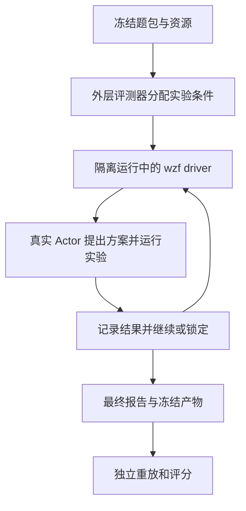

# EEG FM 下一阶段任务书：接通研究流程，完成真实 BrainPEC 子问题

> 给继续执行的 Codex：用户已授权你自主规划和推进本阶段，普通选题、实现、审查与修复无需逐项询问。使用当前环境可用的 `subagent-driven-development` 或 `executing-plans` 工作方式；若没有这些技能，按本文件的依赖和验收要求执行。不要因技能要求再次索取已经授予的普通执行授权。先核对现场，形成简短实施计划，再开始工作。

> 本文件是 Builder 的任务书，包含参考方法与评测设计；不可直接作为受测 Actor 的提示或放入其可读目录。原 Codex 会话继续担任 Builder，受测 Actor 仍由独立上下文和隔离工作区启动。

**目标：**让真实 Codex Actor 经由 wzf 的研究流程，在真实 EEG 数据上完成一个有科学意义的分析任务；将它接入冻结题包、证据审计和独立评分，并在资源允许时完成预先冻结的 skill 对照。

**架构：**外层研究能力评测器负责题包、隔离、条件分配和评分；内层复用 wzf 的 driver、状态、attempt、作业、冻结和报告机制执行研究。评分器不向研究过程泄露隐藏参考答案。

**技术基础：**当前项目 Python、Git、Codex CLI 与 Linux 隔离启动器；分析依赖按实际需要安装 NumPy、SciPy、scikit-learn、PyTorch、MNE 等。复用当前实现，不建立第二套通用 Agent 平台。

**设计依据：**本文件第 1–5 节就是本轮设计；第 6–12 节为执行计划和验收。现场源码优先于本文关于现有实现的描述；本文规定的科学边界和数据保护要求继续适用。

日期：2026-10-29，北京时间。新会话沿用实际启动时间，不伪造“昨晚”的运行记录。

---

## 1. 用户的重点与本轮交付

用户不需要亲自逐条审核评分粒度、重放依赖、split 绑定等技术细节，已将其交给执行者。用户最关注真实科学问题，以及旧研究流程与新评测流程能否连起来工作。

本轮按以下顺序争取成果：

1. 一个资源身份清楚、能够执行的真实 EEG 研究任务。
2. 一条**真实 Codex + 真实数据 + wzf driver 全生命周期 + 隔离评测**的完整轨迹。
3. 可读的科学结果：研究了什么、做了哪些关键实验、发现什么、哪些解释仍不成立。
4. 条件允许时，在同一冻结任务上完成 baseline / skill 配对比较。
5. 支撑上述结果的必要代码改进、重放、评分修复与中文说明。

不得用新增测试数、文件数、token 消耗或运行时间代替前四项。不能为了跑满时间而扩大框架、反复做已经通过的合成测试。

### 已有结果如何承接

以下来自用户贴出的早报，须在现场核实：

- Windows 正式仓库：`X:\projects\EEG-AI-Scientist`。
- 当前分支：`research/overnight-20261029`；已知提交 `58b8d71`；本地与服务器当时一致、干净、未 push。
- 服务器活动仓库：`/data/duandh/eegfm-stage-a-20261028/overnight-20261029/integration`。
- 服务器框架：上述目录的 `framework/`。
- 原始导入副本：`/data/duandh/eegfm-stage-a-20261028/source/eeg-fm-research`，已知快照提交 `fb6c37e`，继续保留原样。
- 基础环境：`/data/duandh/eegfm-stage-a-20261028/venv/` 与 `environment.sh`。
- 前轮 Linux 测试 79 + 14 项通过；真实隔离 canary 最终通过；一次 dev、独立蒸馏、四次合成 holdout 已留档。
- 前轮只有一对完整对照，未证明 skill 改善；真实 EEG 试验尚未完成。
- 旧 24 次预算已用完。不得修改旧账本或复用 M01–M24。

先读现有 `MORNING_SUMMARY.md`、`RESULTS.md`、`RESUME.md`、`PATH_MAP.md`、`ACTOR_LAUNCHER.md`、`ISOLATION_REPORT.json`、`PROCESS_AUDIT.md`。只沿着具体问题读取证据，避免重新通读全部 646 个文件。

本任务书作者未连接用户的 Windows 或实验室服务器，也未审查昨夜修改后的完整源码。公开论文、官方代码核对与用户报告必须区分。

## 2. 选定的科学主线

### 2.1 主问题

**给定一个已经训练好的 EEG 分类模型，哪些经典 EEG 信号属性可以从它的内部表征中恢复？这些可恢复的信息中，哪些对它的预测行为有可信的影响证据？**

直观例子：能从表征里读出某个频段的能量，不代表分类模型一定靠这个频段完成判断。需要实验区分“信息存在”“预测依赖”和“扰动带来的普遍损坏”。

这是从 BrainPEC 的编码与使用问题中选出的切片。BrainPEC 同时研究 CSBrain、CBraMod、LaBraM；本轮优先 **CBraMod × Mumtaz（MDD）** 一个组合。该选择是本轮的范围决策，不意味着预先知道这个组合或某个特征应出现什么结果。[S1, S2]

### 2.2 三个相连的检验问题

| 问题 | 需要得到的证据 | 允许得出的结论 |
| --- | --- | --- |
| Q1：指定特征能否从表征恢复，在哪些层更明显？ | 训练拟合、验证选择、独立测试；有效的目标打乱/随机目标对照；逐层结果 | 某种读取方法能够恢复这些信号属性；失败不等于模型完全不含该信息 |
| Q2：针对特征的信息干预是否改变预测？ | 冻结的模型与输出头；有效干预；原始和干预后的配对预测；随机扰动等对照 | 在规定的模型、数据与干预方式下，有或没有预测依赖证据 |
| Q3：这种变化能否排除粗暴损坏和无效对照？ | 干预强度/维度、残余可恢复性、对照有效性、被试依赖与不确定性检查 | 证据是否足以支持当前解释，或仍需更强实验 |

不要求结果必须显示“能读出但没使用”。证据不足、控制无效、未发现差异都是合法结果。不得把内部表征干预解释成大脑中的生理因果关系。

### 2.3 范围与扩大顺序

目标是一个模型—数据集组合的完整分析；不一次启动论文全部模型和数据集。

1. **接线验收：**在训练部分做一个 batch，再做小样本分析，测量时间、内存和缓存大小。不用最终测试结果决定扩大方向。
2. **最小真实任务：**预先固定一个跨特征家族的小面板，建议每家族按官方 registry 顺序取前两个，共 12 个。若部分特征在当前通道数、采样率或方差条件下无定义，记录原因；替换规则必须在观察科学结果之前确定。
3. **完整单组合分析：**实测成本允许时扩展至官方 registry 中 63 个候选特征和实际可分析层。这里“63”是待检查的目录规模，不保证每个特征在数据上均有效。
4. **有余量的科学扩展：**优先检验干预结论对匹配随机对照、残余信息和被试重采样是否稳健。其后再考虑透明特征分类器的解释能力；不要先增加第二个大模型。

12 特征或 63 特征的**正式评测范围，必须在 Actor 启动前冻结**。若小面板已作为正式任务运行，再扩大时建立新任务版本；不得将两个范围混成一个分数。

小面板可采用官方 registry 的以下条目，现场须校验 ID 与定义：[S4]

`T001_hjorth_activity`, `T002_hjorth_mobility`, `F001_delta_log_power`, `F002_theta_log_power`, `TF001_wavelet_entropy`, `TF002_wavelet_detail_var_l1`, `C001_permutation_entropy`, `C002_sample_entropy`, `X001_pac_delta_beta`, `X002_pac_theta_gamma`, `R001_corr_abs_mean`, `R002_corr_abs_std`。

这是按目录顺序选择，不能依据参考结果挑选容易成功的特征。`C002` 的实际实现有近似性质；特征名字不能代替计算定义。跨通道特征还需检查有效通道及非零方差。

### 2.4 候选替代顺序

由现场资源决定，但在查看目标科学结果前锁定，写入 `TASK_SELECTION.md`：

1. 匹配的 CBraMod × Mumtaz 数据、任务权重、输出头和划分。
2. 匹配的 CBraMod × Mental Arithmetic / Stress 组合。
3. 若两者都缺任务权重，但有真实数据与公开预训练 CBraMod：建立**明确标注为本项目新配置**的冻结骨干 + 小型任务头，完成独立方法验证；不得冒称原论文模型结果复现。
4. 若缺任务头或算力只支持已有表征缓存：完成真实数据上的 Q1，标为“编码分析子任务”；Q2/Q3 的预测依赖问题仍未完成。
5. 若真实数据也不可获得，保留精确阻塞与已完成代码，不以新增合成研究宣布真实目标完成。

现有 REVE 权重不能无声替代 BrainPEC 的模型；若未来做 REVE，应另列扩展任务。

## 3. 把两套流程接起来

原 wzf 系统本身就承担科研执行。新评测系统负责研究条件和能力评价。二者是内外两层，不是“下面只做工程，上面才做科学”。

### 必须保留的内层能力

brief、审核、评估契约、baseline、attempt、锁定、最终测试、报告和 `done/blocked` 状态都应有真实记录。真实发生的作业等待、恢复和迭代也需留档；正常 episode 不一定需要恢复或多轮搜索，未触发的恢复/超时路径可由短 canary 验收，不人为制造故障凑节点。不要绕开 driver 跑一个独立 notebook 后宣称两套系统已经接通。

但解释型研究不等于追求分类分数越来越高。须检查现有 `keep/discard/frontier` 逻辑：

- 原始分类模型是分析对象，默认冻结；不能为了让解释实验好看而微调它。
- 一个干预让任务准确率下降，可能是重要证据，不能因为分数低就丢弃。
- “最终候选”在本任务中是分析程序、参数、特征/层选择与预定结论规则，不是最高准确率模型。
- 优先增加局部 `analysis` 任务模式或等价配置，保留所有符合协议的正负结果；不要重写原有优化任务的行为。
- 内层的 baseline 是未干预模型/初始实验方法；外层的 baseline 是不注入 skill 的 Actor。文档明确区分。

### 连接时最容易漏掉的隔离

旧 driver adapter 曾显式启用联网、Web 和宽环境继承；不能只给题包加禁网字段。所有受测启动必须实际经过已验收的隔离启动器，任何降级都标成诊断运行。

每个 episode 有独立工作区、允许读取的运行历史和 memory。driver 可以多次唤醒同一个研究 episode，但不得读其他 episode、Builder 对话、参考实现、gold 或全局科研 memory。

模型客户端连接 OpenAI 与 Actor shell 任意联网是不同通路。沿用已验证的客户端/工具边界；不要为了禁网切断必要模型请求，也不要为让模型请求成功而放开 Actor 工具网络。

真实源数据只读提供给可信执行层；输出、派生缓存和代码写在自有目录。Actor 通过按分割限制的接口读取允许的训练/验证材料，不直接挂载同时含 train/val/test 的整个 LMDB 或数据根目录。不要为隔离去复制或改动既有源数据库；优先由可信加载器按冻结 ID 提供视图。路径名和元数据也不能暴露隐藏样本或标签。

本任务的 Q1 目标可以从 EEG 直接计算，所以隐藏类别标签仍不够：**最终测试 EEG、特征目标、表征缓存和可定位样本的私有元数据，锁定前都不可供 Actor 访问。**最终测试由可信执行层运行；Actor 提交的程序只获得规定的计算输入，不能读取评测标签、私有参考或任意宿主文件。不能让不受信任的任意 Shell 命令继承可信执行层的权限。

已有 driver/jobs 的提交接口若可指定任意命令和宿主路径，须对受测模式限制工作目录、输入白名单、固定评估入口和输出回传。请求中的 run/split/候选哈希由可信层核验，不能仅信任 Actor 可改写的 STATE.json。最终评分只能消费冻结产物。

### brief 审核如何无人值守

本轮用户已委托普通规划与执行。可用预先冻结、只检查资源/范围/协议的规则审核器或看不到 gold 的审查者推进 brief。记录 `approval_mode=delegated_protocol_review` 及审核者身份，不得写成用户亲自审核。

原 CLI 若把所有 approve 都记为 `actor=human`，需要局部修复身份记录，而不是让自动审核伪装成人工。审查反馈不能教 Actor 论文方法或预期答案；两组使用同一审核规则。

涉及新增付款、数据访问申请、管理员权限或未获分配 GPU 时，记录具体阻塞，不代替用户同意。

## 4. 资源核查与可行路线

### 4.1 本次公开代码核对已知的实际限制

- 官方 `inference/run.py` 和 `factor_atlas.py` 入口拒绝 CPU。CPU 方案须明确实现与验证适配入口，不能仅猜一个 `--device cpu` 参数。[S3, S4]
- 官方文档给出下游微调权重目录和文件名，未在该文档提供对应权重下载链接。公开预训练 backbone 不等于这些完整任务模型。[S2, S3, S7]
- 发布的 Mumtaz/Stress CBraMod 模型包含非线性输出头，而论文相关描述使用“线性头”。须记录实际结构及协议差异，不自行替换后仍声称严格复现。[S1, S5]
- 官方脚本不是给一个特征白名单就只算这几个特征；小面板需要局部筛选适配，现场核对可用参数。[S4]
- 现有均值池化表征缓存可用于探测，但不足以重建全部中间激活并继续原模型前向；不能把缓存上的线性操作直接包装成原模型干预。[S4]
- 文件名中的 recording ID 不必然等于 participant ID。必须从实际元数据核对同一被试的不同条件、记录、切片是否跨分割。[S6]

这些是核查点，不是已经在用户数据上发现了错误或泄漏。

### 4.2 必须建立的资源表

`RESOURCE_MANIFEST.json` 至少包含：

| 类别 | 必填内容 |
| --- | --- |
| 数据 | 实际路径、来源与使用条件、版本、文件清单或有效校验、样本与被试标识、标签定义 |
| 输入 | 通道名与顺序、采样率、单位、滤波、参考、窗口、缺失通道处理、最终张量形状 |
| 划分 | train/validation/test 的 sample ID 和规范化 subject ID；数量、类分布；交集检查 |
| 模型 | 代码提交、结构配置、权重来源/哈希、预训练或下游微调身份、strict load 结果 |
| 输出头 | 实际结构、输入形状、训练数据/划分来源；是否与权重整体匹配 |
| 缓存 | 生成代码/模型/预处理/分割哈希，逐行 sample ID，内容类别与可支持的分析 |
| 资源 | CPU、内存、存储、GPU 分配证据、依赖版本、运行目录和预算 |

还需核对**整个下游微调模型**的监督训练数据/被试，而不只是本轮输出头。不能重新划分已有数据后，把模型微调时见过的被试称为独立测试；新任务头只在本轮训练分割拟合。若旧权重训练身份无法核实，可做明确限制的表征分析，但不能作独立预测泛化声明。骨干预训练与下游监督暴露分别登记。

只在已知项目清单、registry、明确挂载和用户自有路径内做有限定位，不递归扫描整个实验室存储。没有 GPU 分配，看到空卡也不能使用。

### 4.3 避免再次只剩合成结果的路线

先限时寻找已有匹配资源。如果缺件，允许在本轮预算内使用官方、公开、无需新增账户或签署条款的小资源，并保留许可与来源。

一个明确备选是 PhysioNet EEGMAT：它提供真实 Mental Arithmetic EEG，公开页面列出的完整未压缩大小约 175.1 MB。它不是现成 BrainPEC LMDB，也不能把“算术任务”和“临床压力”直接画等号；需从预处理和标签定义核实实际任务。[S8]

本轮允许在自有缓存中下载这一个小型公开数据集，作为以往“不批量下载数据库”默认规则的限定例外。**既有实验室 dataset 的禁止修改、移动和复制约束不变。** 不下载其他大数据库、不批量拉模型。若现场用户另有更严格限制，以其为准。

已有数据只读；允许生成必要的派生特征、表征和分析结果。公开 CBraMod 权重只从其官方仓库指向的位置获取，记录身份；缺下游权重时只能走明确标记的适配研究路线。

没有 GPU 时，先测真实一个 batch 的 CPU 适配。根据实测推算成本，能在预算内完成则推进；不能则用有来源的缓存或缩小到 Q1。不得凭“模型不大”承诺一夜完成。

## 5. 科学协议与评测边界

### 三类运行必须分开

| 类型 | 可看论文/参考方法 | 用途 |
| --- | --- | --- |
| 参考实现 | 可以 | 验证资源、方法和局部结论，生成私有参考与可重放证据 |
| 隔离 Actor 研究 | 不可以看目标论文方法、结果及完整参考代码 | 测研究方案、实验选择、证据解释与执行能力 |
| skill 对照 | 同上，实验组额外看到冻结 skill | 检查额外科研经验是否改变研究行为和结果 |

完整 BrainPEC 仓库包含方法、结果图和带答案的说明，不能直接挂到 Actor 中。可提供经过审查的通用模型、数据加载和基础运算接口；明确记录提供了哪些能力。若直接提供论文专用 Probe→Erase→Closure 流程，须命名为“给定方法的执行评测”，不能称为自主设计方法。

### Actor 公开题目的建议表述

> 在给定 EEG 分类模型、数据和计算预算下，研究预先列出的信号属性与模型内部表示及预测行为的关系。自行设计能够区分不同解释的实验，报告证据、反例与局限。允许结果不支持最初假设；所有结论必须能追溯到指定数据分割和可重放产物。

最终题目不包含具体擦除算法、最优层、预期差异、论文表格、特征因果标签或参考数值。本任务属于约束范围明确的研究切片，不声称复现整篇论文的开放探索难度。

### 两次拆解继续作为方法核心

1. **论文→问题树→任务：**复用昨夜研究树，逐项核对来源与资源，选与主问题对应的节点；把范围约束写清，把方法和结果留在私有参考。
2. **报告→原子主张→证据和参考比较：**分别处理是否复现参考发现、是否有有效新发现、实验是否执行正确。禁止再让一条有额外区间的长句拖垮所有正确子结论。

### 本轮统计与最终测试规则

- 所有拟合、标准化和干预估计使用训练部分；层、正则化、特征选择和分析方案在验证部分确定。正式检验范围、对照、统计方法与判定规则在参考实现首次查看最终测试结果前冻结；参考侧调试也只能用训练/验证数据。最终测试封存到程序与决策规则锁定之后。
- 每个 episode 默认只解封一次锁定方案的最终结果。可信层保存不可由 Actor 改写的锁定哈希、调用计数和提交状态；重复请求返回同一结果或明确拒绝。纯技术重试只运行相同冻结产物，按预定规则留档。最终报告可补充对已冻结输出的描述，但不能再选层、选特征、调方法或选择更好候选。
- 独立审计可对相同冻结产物复算，不提供新的适应性反馈给 Actor；审计发现缺陷时保留失败，不让 Actor 根据测试反馈修到通过后仍沿用原确认性结果。
- 各独立 episode 可按同一预定协议使用相同最终测试集，但彼此看不到结果，也不能据此修改中途的公共工具、skill 或评分规则。发生协议修改时结束当前版本，另记新版本及已知暴露。
- 按真实 participant ID 划分，不能只保证 epoch 或 recording ID 不重合。同一被试重复窗口的不确定性，主分析或稳健性分析使用被试层级重采样；说明与参考实现是否不同。
- 保留原始未截断的探测指标及对照；若展示截断版本，另列字段，不用图表截断掩盖低于基准的结果。
- 干预检查有效性和残余可恢复性，并比较预定随机/打乱对照。打乱方案必须说明破坏什么依赖、保留什么结构，并检查没有退化成恒等对照。
- 对照维度、实际秩、扰动强度均记录。按本项目新协议匹配实际秩的稳健性检验，与原协议运行分开命名。
- 多特征推断冻结检验族和校正规则；配对重采样用共同索引。建议缓存预测上的确认分析使用至少 2,000 次有效重采样，先测成本；若做不到则明确精度/功效限制，不把低分辨率 p 值当充分的无差异证据。
- 若做透明分类器/closure 扩展，特征选择必须在最终测试前完成。不能用最终测试确认“哪些特征好”后，再在同一个测试集上宣称该选择的独立解释能力。
- 文本语义评分不替代数值、分割、运行和统计核验。不同方法得到有依据的新发现，可进入额外发现栏，不强求每句都被论文覆盖。

### skill 的两种合法安排

**默认较省资源方案：**先审查昨夜 M15 仅根据合成 dev 蒸馏出的 skill 的内容与来源。在新真实任务运行前固定原始字节，比较无 skill / 固定 skill。它测的是“合成开发经验向一个真实任务的迁移”，不是本轮已经完成真实任务间 RSI。

如果要修改该 skill，只能用旧 dev 材料和公开通用方法；不得吸收当前真实 holdout 的参考答案、Actor 结果或评分。修改后另记版本、来源；Builder 手写的内容标记 `builder_designed`。

**扩展方案：**只有两套独立真实任务资源已准备好，才能提前冻结 real-dev 与 real-holdout，再让 Distiller 只看 real-dev 的脱敏轨迹及反馈。不能把已经用于调 skill 的任务后来重新命名为 holdout。相邻特征或同一数据的重新分割，只能称为较弱的同域迁移，不是未见论文或跨任务泛化。

EEG 的 train/validation/test 是**一个研究任务内部的数据划分**；Agent 的 dev/holdout 是**用哪些研究任务改进 skill、用哪些研究任务测试 skill**。二者分别登记。

## 6. 预算、时间与调度

这是新的研究轮次，默认工作窗口 **12 小时**，最后 45 分钟留给收尾。用户在执行会话指定其他上限时以其为准。以下是交给执行者的本轮默认预算，不是本文件已经启动了运行。

| 资源 | 本轮默认上限 |
| --- | --- |
| 额外模型工作 | 总计 48 次启动，包含 CLI 会话、Builder 子工作者、蒸馏、评分、失败与取消；最多 2 个同时工作 |
| 主会话 | 同受总时限与账户配额约束；不能用未计入额外启动数的主会话反复代理 Actor 来绕过预算 |
| Actor episode | 最多 6 次模型会话、累计模型会话时间 90 分钟；计算作业另受全局预算，具体每次限制在题包中公开 |
| CPU/内存 | 本轮计算合计默认 4 线程、12 GiB；控制 BLAS/OpenMP 和子进程。若只能采样监测，明确其不是内核硬上限 |
| GPU | 默认 0；已有明确分配时最多 1 张、累计最多 4 GPU 小时，并服从分配到期时间；不申请付费云资源，不抢占 |
| 存储 | 自有工作盘新增最多 20 GiB，停止线为工作盘空闲低于 20 GiB 或 home 低于 4 GiB；不清理旧证据或他人文件 |
| 下载 | 依赖、官方权重和上述限定公开数据合计最多 8 GiB；先估算，禁止无上限递归下载 |
| 重试 | 同一可重试故障至多 2 次；认证错误立即停相关分支；持续网络故障 10 分钟后转离线工作 |
| 配对实验 | 先争取 2 对完整 baseline/skill；资源允许至多 3 对。运行顺序预定、两组资源相等；独立 EEG 样本数不能当作 Agent 重复次数 |

所有模型启动统一登记；新 ID 建议 `R01` 起，预算路径与昨夜分开。保留至少 8 次额外工作额度用于收尾评分和审查；基线端到端未成功前，不同时启动多个昂贵对照。

每阶段开始做预算准入：剩余时间、调用数、磁盘和 GPU 配额必须足够覆盖拟启动工作及收尾。GPU 累计包括适配训练、参考、Actor、重放和稳健性实验。下一对实验只有在实测成本支持**完整一对加收尾**时才启动；三对是上限，不是必达目标。六个 Actor 都用满六次会话就需 36 次，不能忽略构建和评分开销。优先保住第一条真实端到端轨迹。

阶段时间用于判断是否转向，不是强制花完：

- 0–30 分钟：现场恢复、路径/预算、已有工作核查。
- 30–120 分钟：资源定位与匹配、小批量成本测量；并行处理评分和重放的必要缺口。
- 随后 2–4 小时：打通 driver 的真实分析任务，完成参考路线与冻结。
- 剩余主要时间：真实 Actor、必要的配对比较和科学稳健性分析。
- 最后 45 分钟：停止新作业，审查、同步、中文交接。

首 90 分钟仍没有任何真实可用路径时，明确选公开资源适配路线或登记不可解除的阻塞。不要继续无限找文件。没有可工作的真实路线时，12 小时上限不是要求继续空转。

资源已就绪时，目标在第 4–6 小时前启动首个真实 Actor。评分增强工作包 B 初轮合计限时 90 分钟，优先完成隔离、测试封存、split 绑定、关键数值重放和真实成功状态等阻断项。尚未完成的文本评分校准可标“待审”，不阻塞有协议和证据的真实研究；但不得据此发布已验收的正式分数。正式对照所需的评分规则仍须提前固定，后续修规则的重算只能另列探索性诊断。

## 7. 工作包 A：恢复与路径清晰化

**涉及：**当前根目录文档、Git、现有恢复与代理脚本；不修改旧研究产物。

- [ ] 核对当前 HEAD、分支、remote、工作树和未提交内容。保留用户改动，从核实后的当前分支建立 `research/brainpec-real-20261029` 或实际日期命名的新分支。
- [ ] 不重置回 `58b8d71`；它只是已知锚点。原始 `fb6c37e` 副本不动，不混合不相关历史。
- [ ] 复用已有环境和受测 CLI 安装，不默认升级 CLI、不重装已经可用的隔离工具、不重新登录。
- [ ] 代理继续用现有 Windows 脚本与动态端口。只有确有网络需求时启动本轮 helper；不要停止非本轮拥有的 SSH 或代理进程。
- [ ] 建立本轮 `PATH_MAP.md`，同时给出 Windows、服务器、Git 根、框架、真实数据、缓存、运行、报告、私有参考的准确位置。
- [ ] 保留 `integration` 作为现有服务器代码工作区，不在科学运行中途搬家。项目根增加或更新简短中文入口 `START_HERE.zh-CN.md`，解释代码、数据、实验与快照的位置。
- [ ] 新报告建议放 `docs/research/2026-10-29-brainpec-real/`；私有证据放 `.local/research/2026-10-29-brainpec-real/`；服务器计算产物放自有 stage 下的新轮次目录。若项目已有等价布局则复用并明确映射。

**验收：**用户打开入口即可找到“原 wzf 副本”“我们修改后的代码”“本轮在跑什么”“结果在哪”，无需翻 bundle 文件猜测。

## 8. 工作包 B：必要的评分、重放与证据修复

**核查/可能修改：**`framework/eegfm/research_bench/claims.py`、`scoring.py`、`evidence.py` 及现有重放实现、相应 `framework/tests/research_bench/`。文件名和 API 以现场为准；不另起评测框架。

### B1. 用一份报告解释评分在测什么

- [ ] 选择 M20 与 M21 中一对对应的争议段落，查看原始报告、原子抽取、参考主张、支持边及数值证据。
- [ ] 形成中文 `OLD_SCORE_CASE_STUDY.md`：原句、拆解、数值是否对、参考是否覆盖、为何旧规则扣分。只看必要片段，不人工重判所有昨夜输出。
- [ ] 旧任务/分数保留。诊断性重算另列，标明已看过结果，不能作为新确认性改善证据。

### B2. 新评分规则

- [ ] 一条原子主张保留对象、条件、分割、方向和必要限定；将点估计、区间、额外机制解释分开。不要为了 30 条上限将多条事实重新拼成长句。
- [ ] 超额时用可审计分段抽取、去重或标记截断，不能静默丢弃；公开上限和处理策略。
- [ ] 分开输出：参考发现覆盖、数值/证据有效性、参考未涉及但可验证的新发现、矛盾或缺证据主张、实验过程质量。保留参考 P/R/F1 作为一个维度，不制造未经校准的 taste 总分。
- [ ] 冻结新协议版本、提示、抽取器、judge 配置，以及与本轮真实任务隔离、具有明确预期判定的开发校准集。校准样例需要标准答案，但不能包含当前真实 holdout 的答案。
- [ ] 必要测试覆盖：正确主张附加错误区间、拆句/合句语义不变、重复主张、空提交、reference 未涉及的正确发现、同名不同 split、外部服务失败。

### B3. 重放与 split 绑定

- [ ] 运行前公开依赖与命令约定：输入、输出、顺序、工作目录、环境、选项、随机种子、允许命令数、超时和可写范围。消除 M20 那类事后才出现的限制。
- [ ] 产物区分确定性科学结果与时间戳/耗时/文件清单等诊断，不能仅凭诊断哈希变化否定所有科学重放。
- [ ] 每条指标关联 `artifact_hash + row_selection/sample_ids + split_manifest_hash + calculation`。混合 train/val 文件逐行绑定，或生成明确分割的视图。
- [ ] 在干净目的地重放一条依赖链；缺依赖、分割错配、篡改数值应产生明确失败。只对相关实现做必要回归，不通过重复测试消耗时间。

**验收：**相同发现不会仅因排版打包不同变成完全不同结论；评分能区分“参考外”和“错误”；第三方可重放本轮规定产物。

## 9. 工作包 C：真实资源、参考结果与任务冻结

**涉及：**资源 manifest、官方分析代码的固定版本、自有适配层、现有 `framework/benchmarks/brainpec_pilot/`。参考代码与 gold 放 Actor 之外。

- [ ] 按第 4 节建立资源表、严格加载模型、验证单位/通道/形状/分割。初始化或随机权重不能当真实预训练权重。
- [ ] 固定依赖与官方代码提交。本文检查时 BrainPEC 提交为 `982b1df393a846e6418cee715bdfaa57d041cee3`；现场核实可用性，固定实际使用版本，记录差异。
- [ ] 实际执行一个 batch，记录吞吐、内存和预测是否有效；再测特征、探测和必要干预。禁止直接启动全量 `run_all.sh`。
- [ ] 用训练/验证部分确定正式任务规模。资源不足时缩到 Q1 或更小面板，明确任务名和结论边界；不能在看 test 结果后换数据集或特征。
- [ ] 对“原协议复现”和“本项目适配协议”分别记录配置、差异及能比较的结论。代码/论文不一致时保留问题，不暗中修改成自己想要的协议。
- [ ] 在训练/验证调试后冻结参考分析协议，再生成最终参考结果与私有原子主张。论文未明确给出本切片结果时，以透明、验证过的参考实跑证据为依据；不要从全论文汇总率推断某个子集必然有某种结论。参考结果不理想时也不能在同一最终测试集上挑选更好协议。
- [ ] 复用并更新研究树，冻结公开任务、资源接口、预算、评分、参考和条件顺序的哈希。公共目录做内容检查，去除论文方法、结论、历史答案和其他组产物。

**验收：**存在一个实际能运行、有独立参考证据、范围明确的真实任务包；严格复现或适配分析的身份明确。

## 10. 工作包 D：真实 Actor 经 driver 跑通

**核查/可能修改：**`framework/eegfm/driver.py`、`cli.py`、`evaluation.py`、状态/attempt/jobs 模块，`research_bench` Actor 与启动器、任务 `TASK.md/task.yaml`。先读新源码，再做最小连接改动。

- [ ] 将 driver 的受测 adapter 接到现有隔离 launcher，显式提供单 episode 的允许文件和运行记忆；不要使用默认宽权限 adapter。
- [ ] 明确 ID 关系：一个 episode 对应一个研究 run，run 下有多个 attempt，attempt 可有多个 job；case 可有多个 episode，condition 属于 episode。事件与输出带相应关联键。
- [ ] 按第 3 节调整解释型研究的选择逻辑及审核身份；旧优化任务保持兼容。
- [ ] 对真实连接路径重新做短 canary：公开输入可读；本运行可写；参考答案、其他运行、祖先 AGENTS、认证内容和外网工具不可读/不可用。记录实际工具表。
- [ ] 先跑一条真实无 skill Actor。保留其 brief、审核、baseline、至少一次有科学目的的分析/对照、作业状态、锁定、最终测试和报告。
- [ ] “done”需同时有成功执行状态、完整提交和必要产物；容量错误、超时、无报告不能记为完成。正结果不是完成条件。
- [ ] 独立重放主要数值与关键图，并做 evidence/split 审计。

若已有接口只能让 Actor 单次运行而无法经 driver 完成，必须记为“独立真实任务完成、双流程连接未验收”，不能混为一谈。

**必需回归情形：**容量错误非成功、超时无孤儿进程、等待作业可恢复、迭代上限、未锁定不能最终测试、锁定后修改代码/重复测试被拒绝、混合 LMDB 与测试特征不可绕过分割接口读取、跨 episode 信息读取拒绝、自动审核不冒充人工、分析负结果不会被优化逻辑删除。

## 11. 工作包 E：skill 对照与科学扩展

先确保 D 已实现，且比较协议已经在首个正式 Actor 前冻结；否则第一条运行标为开发/诊断，另开新的正式评测，不能事后转正。

- [ ] 核验待用 skill 的精确字节、dev-only 来源和答案泄漏风险；记录是否原封不动复用 M15。
- [ ] 配对组共享模型版本、任务包、算力预算、工具、时间上限和审核政策；只改变指定 skill。顺序预先安排，不总让同一条件先运行。
- [ ] 争取 2 对完整运行，最多 3 对。所有失败与取消保留。外部容量故障不视为能力零分，按事先固定的重试/缺失规则处理。
- [ ] 比较：关键结论、对照是否有效、能否区分可恢复性与预测依赖、是否处理替代解释、证据是否可重放、资源代价。逐项展示，不只报 F1。
- [ ] 若只有一对、未改善或两组都成功，如实报告。多个 episode 仍只是一个任务上的重复，不能据此宣称通用 taste、跨任务自改进或 RSI。
- [ ] 只有预算充足且主线完成，才做一个额外消融：等长度通用提示，或第二真实任务上的冻结迁移。新条件须在看到其结果前登记，不筛选最佳一次。

科学扩展优先采用缓存上的稳健性分析，减少重复模型前向。新增分析如果是在看最终结果后提出，标为探索性，后续独立验证前不升级为确认性发现。

## 12. 交付、验收与停止条件

### 给用户的中文交付

根入口和本轮报告以中文为主，代码/字段名可保留英文。至少包括：

1. `NEXT_STAGE_SUMMARY.zh-CN.md`：一页说明问题、实际研究对象、完成状态、主要发现、意义与限制；写明运行在何处、还剩哪些进程。
2. `SCIENCE_RESULT.zh-CN.md`：主问题、关键图表、数值与证据、正确与不足的推理、后续最值得做的一个实验。
3. `AGENT_CASE_STUDY.zh-CN.md`：一条真实 Actor 的“想法→动作→结果→改判断”轨迹及评分解释；若真实 Actor 未运行，不用旧合成报告冒充。
4. `INTEGRATION_ACCEPTANCE.md`：每个生命周期节点的实际事件、代码位置和产物，区分 scripted / real Codex、synthetic / real EEG。
5. `RESOURCE_MANIFEST.json`、`TASK_SELECTION.md`、冻结协议、预算账本、证据索引和恢复入口。
6. `CHANGES.zh-CN.md`：相对本轮起点的改动，特别是 driver、分析任务、隔离与评分；说明哪些在维护分支、原始 wzf 快照仍在哪里。

### 明确结果状态，不再只写 L1/L4

| 结果标签 | 含义 |
| --- | --- |
| 真实研究与双流程连接完成 | 真实 Actor 经 driver 完整执行，报告与证据可核验 |
| 真实分析完成、连接未完成 | 实际 EEG 分析完成，但未满足 driver 全链路验收 |
| 真实编码子任务完成 | 只完成 Q1，不能宣称已证明预测依赖 |
| 参考实现完成、受测研究未完成 | 已知方法可运行，但没有合格的隔离 Actor 结果 |
| 资源阻塞 | 精确列出缺件、已核查的位置与来源、已能做的部分 |

skill 比较单独标记“未运行 / 运行不完整 / 完整但无改善证据 / 本任务出现差异”；不把一次正差异自动称为能力提升。

上述标签可组合，另外统一列出三个字段：`科学范围=Q1 或 Q1–Q3`、`执行主体=参考实现或真实 Actor`、`driver连接=完成或未完成`。例如“真实编码子任务完成，双流程连接完成”是合法的阶段成果，但不能被读成预测依赖问题也已解决。

### 保存与协作

- 每个可独立验收的改动适当提交；本地与服务器通过现有同源方式同步，确认 HEAD 和未提交内容。不要覆盖用户改动。
- 保留旧结果、旧分数、失败轨迹和原始快照；本轮使用新目录、新 ID、新预算和协议版本。
- 本轮默认不 push、不创建公开仓库、不向合作者发送消息。若执行会话已明确授权 push，则先审查所跟踪内容，按已授权范围发布维护分支，私有 gold/证据/认证材料仍不上传。
- 备份只做必要增量；认证不打包。收尾停止本轮拥有的后台进程；对仍在执行的合法计算任务提供明确状态与取消入口，不用模糊的“后台还会继续”。
- 任务失败或资源阻塞时，交付已完成工作和准确的下一步，不把分数修好、文档写好作为真实科研任务已完成。

## 13. 自检重点

执行者在收尾前逐项核对：

- [ ] 我们真的用了真实 EEG 和已识别的模型，而不是随机权重、匿名缓存或合成替代？
- [ ] 这条真实 Actor 轨迹真的经过 wzf driver，而不是只在旁边跑了一条新流程？
- [ ] Actor 实际工具权限、公共代码和运行记忆都没有暴露答案？
- [ ] 被试与分割有可靠身份，测试没有参与选择？
- [ ] 读取信息、干预依赖、任务性能和生理解释没有混在一起？
- [ ] 语义分数、数值正确、重放与科学有效性分别报告？
- [ ] skill 条件与比较规则事前冻结，所有启动保留，外部服务故障单列？
- [ ] 用户能在中文入口中找到代码、任务和结果？

## 14. 来源与可核对入口

这些链接供 Builder / Reference 使用，不是默认 Actor 可读资源。公开源码会变化；执行时固定版本。

- **[S1]** Tang, L., Chen, Q. et al. (2026), *What Do EEG Foundation Models Capture from Human Brain Signals?*, arXiv:2605.11410v2. https://arxiv.org/html/2605.11410v2
- **[S2]** BrainPEC 官方 README 与资源说明：https://github.com/Kian-Chen/BrainPEC/blob/982b1df393a846e6418cee715bdfaa57d041cee3/README.md ；https://github.com/Kian-Chen/BrainPEC/blob/982b1df393a846e6418cee715bdfaa57d041cee3/inference/README.md
- **[S3]** BrainPEC 推理入口：https://github.com/Kian-Chen/BrainPEC/blob/982b1df393a846e6418cee715bdfaa57d041cee3/inference/run.py
- **[S4]** BrainPEC 特征、缓存、探测与干预实现：https://github.com/Kian-Chen/BrainPEC/blob/982b1df393a846e6418cee715bdfaa57d041cee3/src/brainpec/experiments/factor_atlas.py
- **[S5]** 实际任务模型：https://github.com/Kian-Chen/BrainPEC/blob/982b1df393a846e6418cee715bdfaa57d041cee3/inference/models/mumtaz.py ；https://github.com/Kian-Chen/BrainPEC/blob/982b1df393a846e6418cee715bdfaa57d041cee3/inference/models/stress.py
- **[S6]** 任务/标识处理：https://github.com/Kian-Chen/BrainPEC/blob/982b1df393a846e6418cee715bdfaa57d041cee3/src/brainpec/experiments/task_registry.py ；官方上游预处理：https://github.com/wjq-learning/CBraMod/tree/main/preprocessing
- **[S7]** CBraMod 官方实现及权重入口：https://github.com/wjq-learning/CBraMod
- **[S8]** Zyma, I. et al., *EEG During Mental Arithmetic Tasks*, PhysioNet v1.0.0：https://physionet.org/content/eegmat/1.0.0/
- **[S9]** Wang, Z. et al., *FIRE-Bench: Evaluating AI Agents on the Rediscovery of Scientific Insights*, arXiv:2602.02905v2：https://arxiv.org/html/2602.02905v2 。执行时优先核对项目中已有论文；本文借用问题树与原子主张评测思路，不声称实现等同于官方代码。

## 15. 直接交给原 Codex 会话的启动消息

> 继续我们昨夜的 EEG-AI-Scientist 项目。请阅读附件《EEG FM 下一阶段任务书：接通研究流程，完成真实 BrainPEC 子问题》，结合当前代码和已有证据，在 30 分钟内完成现场核对与必要的实施细化，然后执行。优先目标是真实 EEG 研究，以及让真实隔离 Actor 经 wzf driver 完成全生命周期；评分、重放、split 绑定由你按任务书处理。我已委托你在范围内决定具体切片和实现，不需要逐项请我审核。沿用现有代理方案。使用本轮新预算和新协议，不复用昨夜 ID、不改写旧结果。默认最多工作 12 小时、48 次额外模型工作；GPU 只使用已明确分配资源，其他限制按任务书。原始 wzf 快照与实验室 dataset 保持保护。资源不足时按预定真实备选路线推进，不能把又一次合成成功当作真实目标完成。最后交付中文摘要、科学结果、双流程连接证据、代码改动和恢复入口。

