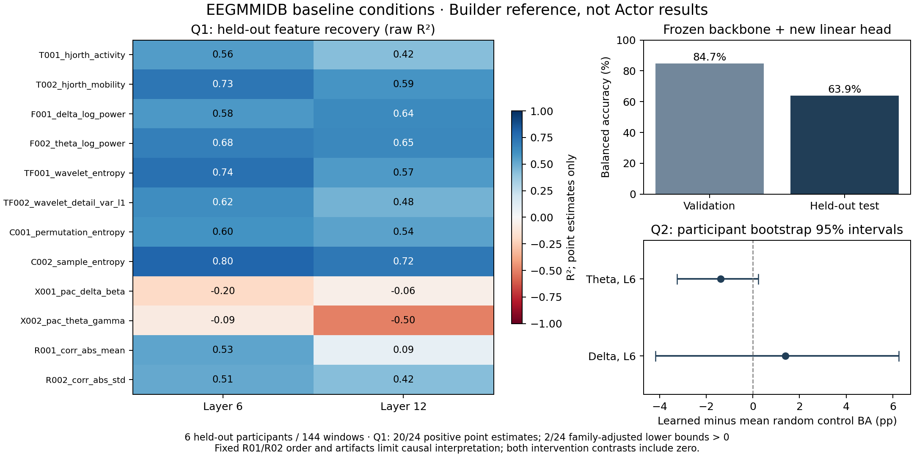

# EEGMMIDB 冻结参考与匿名导出（R87）

2026-10-30 完成。**这是 Builder 的新数据集科学参考，不是 Actor 成绩，也不是技能迁移成功的证据。** 数据任务为 EEGMMIDB 1.0.0 的 R01 睁眼基线与 R02 闭眼基线；没有沿用 EEGMAT 身份、心算标签或耳参考声明。

## 方法与封存

使用 R58 已验证的 72 个官方 EDF 预处理输出：训练 S001–S024（576 窗口），验证 S025–S030（144），测试 S031–S036（144）。每人两条件各 12 个前 60 秒、5 秒非重叠窗口；20 个实测头皮通道包含 FCz，160→200 Hz，单位 uV/100。获取依据、哈希和限制见 [准备记录](EEGMMIDB_TASK_PLAN.zh-CN.md)。

固定官方预训练 CBraMod，训练集均值/尺度和逻辑回归参数仅由训练数据拟合；C=0.01/0.1/1/10 由验证 balanced accuracy 选择，选中 C=10。12 组/62 列特征在第 6、12 层平均池化表示中分别做岭回归；alpha=1/10/100 仅按验证 R² 选择。诊断负对照破坏训练参与者与条件/窗口对齐。验证排名选择两个不同特征组，均为第 6 层、rank=6：theta 与 delta log power。

每组使用三个实际 rank 和逐窗口干预强度匹配的随机方向对照，seed=1301/1302/1303。残余探针同样仅训练拟合、验证选 alpha。不确定性按参与者重采样 2,000 次，seed=20261029；保留 95% 边际区间，以及 Q1 的 24 组 Bonferroni 调整 bootstrap 区间、Q2 两组选中家族的 97.5% 区间。只有六名测试参与者，极端分位数与多重性近似尤其不稳定。

完整 Q1–Q3 范围、科学实现、导出适配器、模型资源、训练/验证拟合、三集合输入与准备来源共 30 个文件于测试前哈希封存。协议见 [EEGMMIDB_REFERENCE_PROTOCOL.json](EEGMMIDB_REFERENCE_PROTOCOL.json)。原参考和 framework/eegfm 源码均未修改。

## 原始失败与有记录恢复

原科学测试进程于 01:25:05 +08 创建一次性 TEST_RESERVATION.json，01:25:08 写出测试表示缓存，随后出现 Intel OpenMP Error #15（libiomp5md.dll 重复初始化），退出码 1，未写出科学结果或预测数组。**测试访问已经开始**；不能称为从未看过测试。原 reservation、缓存、封存源码均保留。

合成矩阵复现了 numpy→torch→矩阵乘法失败，而先导入 sklearn 再运行相同操作通过。恢复仅在同一个 Anaconda 环境提前初始化 sklearn；没有设置 KMP_DUPLICATE_LIB_OK，没有换运行库、修改冻结科学源码、重新拟合或重新选择。恢复入口先验证原 30 文件、原 reservation、缓存哈希以及结果尚不存在，再以排他创建的 TEST_RECOVERY_RESERVATION.json 绑定恢复脚本及原证据；01:26:58 完成原中断评估。这是一次已开始测试的显式续跑，不能当作两个独立测试或无失败首跑。失败摘要另存 TEST_FIRST_PROCESS_FAILURE.json。

## 实际结果

验证 accuracy/balanced accuracy 为 **84.72%**、AUROC **0.9516**；测试 accuracy/balanced accuracy 为 **63.89%**、AUROC **0.6809**。验证到测试的下降保留，未据此调参。

Q1 的 24 组均可估计，20 组 R² 点估计大于 0；仅第 12 层 delta/theta log power 的家族调整区间下界大于 0（分别 0.2106、0.0109）。这不是 20 组显著，更不是特征的因果作用。17 组与诊断随机目标对照的差值 95% 边际区间下界大于 0；该对照不是置换显著性检验。

| 选中特征（层 6） | 原始 R² | 干预后残余 R² | learned ΔBA | learned−平均 random BA（95% 区间） |
|---|---:|---:|---:|---|
| theta log power | 0.6803 | 0.7228 | -3.47 pp | -1.39 pp [-3.24, 0.23] |
| delta log power | 0.5769 | 0.5929 | -1.39 pp | +1.39 pp [-4.17, 6.25] |

两个 learned−random 区间都跨 0；没有强证据说明特征关联方向比匹配随机方向更特异地影响任务。两者残余恢复点估计均略升；不能称信息被擦除。残余 R² 在此只报告点估计，不伪称已有置信区间。Q2 家族调整区间分别为 theta [-3.71, 0.46] pp、delta [-4.86, 6.71] pp。完整 24 组数值、负对照及区间保存在私有 REFERENCE_TEST_RESULT.json。

## 匿名导出和后续接线

数据位置以仓库根目录为基准：

- 公开输入：`.local/research/2026-10-30-extension/eegmmidb/actor_public/`，仅 9 个允许文件：train/validation.npz、通用 eeg_api.py、官方模型源码/权重/许可、仅预测参数的头和资源清单。
- 私有封存：`.local/research/2026-10-30-extension/eegmmidb/private_builder/actor_sealed/`，含无标签 evaluation/test.npz、evaluation/validation.npz、各集合 truth、私有随机映射和合并 split-manifest.json。
- 科学参考：`.local/research/2026-10-30-extension/eegmmidb/private_builder/reference/`；Actor 不能挂载此目录、prepared、resources 来源根或 actor_sealed 根。
- 新任务公开说明：[eegmmidb-task/TASK.md](eegmmidb-task/TASK.md)，任务键为 `eegmmidb-eyes-open-closed-baseline`。其余接口与结果 schema 保持原通用合约。

导出适配器使用真实 S001…/R01/R02 与完整 12 窗口集合校验，不修改 ID 以冒充 EEGMAT。所有来源/缓存元数据逐行一致后才生成 OS 熵的参与者与样本 token 和私有行排列。审计核对 864 行 x、y、features、表示与映射；36 名匿名参与者互斥；公开集合不含原始记录名/窗口索引，测试只在私有目录。数据、模型或私有结果均受 `.local/` 忽略规则保护。

**剩余适配工作：** root 在 E05–E08 完成后，为 controller/episode 的任务 contract 识别和公开文档来源增加新任务范围，用以上任务键与公开目录/封存路径登记新编号、冻结成对条件及预算。现有代码仍绑定旧 task ID，不能直接用 EEGMAT episode 注册命令冒充新任务。此次没有启动任何 EEGMMIDB Actor。

## 核验

边界测试先出现 4 个预期缺失实现失败，实现后通过；联合原科学/导出边界测试为 **28 passed, 1 skipped**。独立后验审计重算 24 组 R²、8 组干预 accuracy/对照差值并核验 30 个冻结文件；仅训练集 API 推理烟测在原 8 窗口顺序/batch 下，feature/layer/logit 最大绝对误差均为 0。

最初任意 3 行 rebatch 的严格缓存等值检查失败（层误差 3.22e-6、logit 误差 2.50e-5），已保留在 POST_RESULT_AUDIT.json 中；恢复相同 batch 后通过，没有改科学结果或放宽阈值。文档初次生成还遇到 Windows 默认 GBK 解码错误，明确指定 UTF-8 后完成；该错误不涉及科学文件。

所有推理使用 CPU、PyTorch 最多 4 线程；GPU 使用为 0。未提交或推送。没有读取凭据或实验室共享数据。

R01/R02 固定顺序、眼动/伪迹、便利样本、未知预训练重叠和仅六名测试参与者均限制解释；不能从当前干预推断生理因果或从新任务参考推断技能迁移。

## 关键哈希

| File / content | SHA256 |
|---|---|
| Scientific protocol | `46fb6ba73e80de5c64f311da84424dbe664b3f010237d163100e6fcbe09d6232` |
| Scientific adapter | `c790af8759685767ea4cc2847146ccd0ae439a1cb37fbd79c74ae67f5ba166d0` |
| Export adapter | `a7e48e51f06fc7fc186f670ae30edcfa008617ea25a5789e8a1ef27422d984a0` |
| REFERENCE_LOCK | `3d00e0a0e20142d2ce1b136595036b8a18b35e8c1a526aaa11eac815805e19df` |
| Original reservation | `2dff826f4190db9ffe664c9572ef4e86fa7368d1b858108dfb96eb1523ce1f33` |
| Recovery reservation | `962d582138ef584c8246cdc4a7918367b760dfca18e186f4a3d994216932471c` |
| Scientific result | `0b7e87a2af5d776c2a1d94333bb37a84b243f96564d7985d471a417f5370e51d` |
| Prediction arrays | `d2e7538ae6e7e485d55e878c33a21b64f63df566c90633221888b6346129886a` |
| Export receipt | `c21fea83365df64172a940ee4a34be10326f5b3059055759f952e70d127aa643` |
| Combined split manifest | `8ba1a18a9745e83ca05351c03b8d9c1ac3e52dcf4e7bbfd5d5e8dec7e29c1740` |
