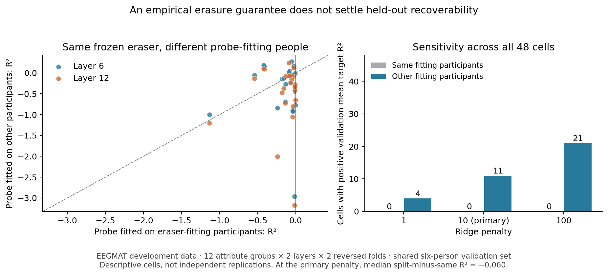
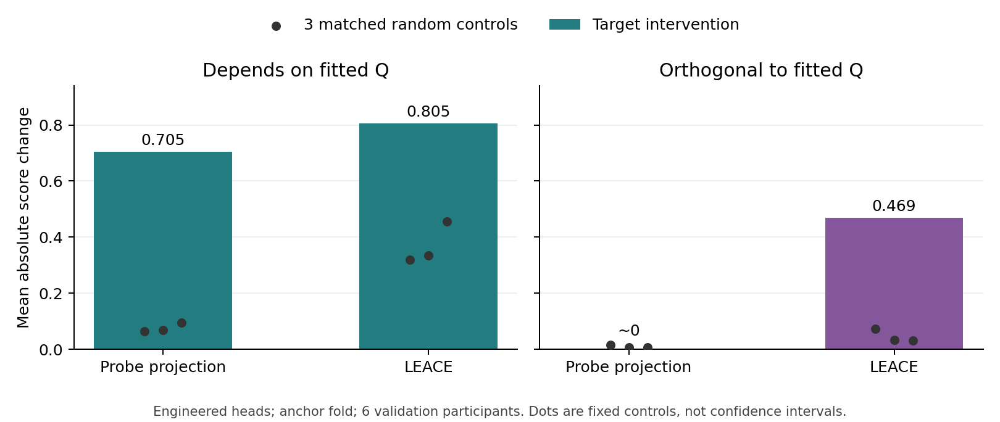
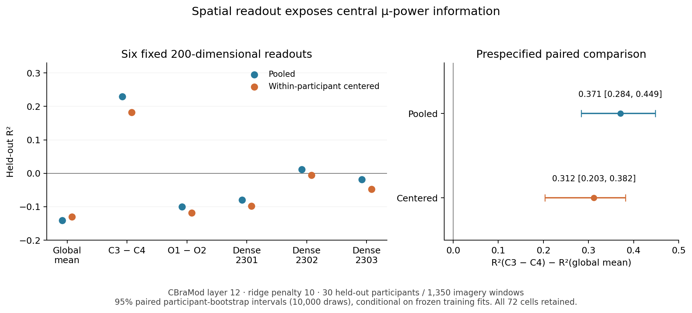
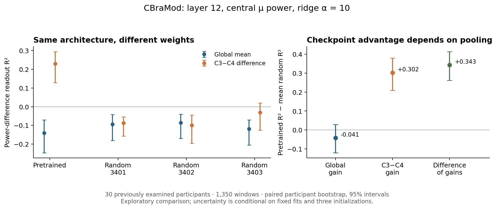

# EEG 实验可靠性与研究决策

本文保留中期实验及首次论文工作流试验的记录。查空间读出、预训练对照、已知机制校准和独立编码研究者的实验，可从下方“目前得到的实质结果”读起。[当时的研究协议](evidence-guided-research.md)

论文工作流随后在第二版完成。独立研究者完成了 LEACE 改编实验及报告，结果通过两次重放；BrainPEC 和 LEACE 两份报告均已与原文逐项对照。至今仍无合格的方法增益或 RSI 证据。[最终结果与适用范围](phase-completion.md)

## 本轮新增：论文工作流试验

以下记录归档第一版（`archive/paper-workflow-trial-v1`）。表中“未完成”描述该版结束时的状态。

| 工作 | 实际完成到哪里 | 能否回答研究问题 |
| --- | --- | --- |
| LEACE 改编的 EEG 残余恢复 | 最终题包 r04 冻结；最后一次运行完成 1 次基线拟合，但研究者未在 480 秒会话内完成提交 | 不能：验证、灵活读出、锁定测试、完整报告和两次复算均未完成 |
| BrainPEC 历史 Q1 报告比较 | 完整原报告六段均送入同一入口；两段主张抽取截断，未进入方向判断 | 科学评价不完整；没有可报告的精确率、召回率或 F1 |
| 运行工程 | 修复实际模型身份、应用入口、控制器时限及逐会话初始上下文核验；通过相关检查 | 只说明实现得到验证，不证明科研能力提高 |

最后一次运行 `residual-recovery-leace-v1-context-review-r02` 的执行器返回基线拟合成功，但没有成功接收的作者会话，也没有验证评分、测试或重放作业。代码与小型拟合产物按原样保留，未通过独立科学审核。**这既不是“残余属性无法恢复”的负结果，也不是一项已经完成的新 EEG 实验。** 没有完整研究报告，因此 LEACE 的报告比较没有启动。BrainPEC 的详细条件与评价缺口见下文历史 Q1 比较。

本轮主要新增的是工程修复和失败诊断，未达到原定完整研究链的结束点。记录显示预审、阅读与工具交互占用了会话时间，但未分离模型推理、I/O 和等待成本；缩短预审等待后仍未完成提交。交互负担与预算匹配是下一阶段待检验的问题，不能据此评价模型科研能力。失败和成本保留，不再在本轮追加重试。

源码 `19d379d` 的 Windows 完整检查为 **1188 通过 / 85 跳过**；私有执行辅助程序为 **195 / 2**；火山云真实 Linux 启动与清理专项为 **262 / 0**。最后一组不是 Linux 完整套件，也没有执行 EEG 任务。原科学数据与拟合、评分、重放预算未因修复而扩大；会话时限的事前校准、实际平台记忆和既有测试数据暴露均有记录，不作同预算盲测或 RSI 声明。

以下按研究问题保留此前的实验与准备记录。

## 目前得到的实质结果

**“属性读不出来”不足以说明模型中已经没有该属性。** 本轮对同一组冻结的 EEG 表征进行了真实实验：如果属性移除操作与检验它的线性读出模型在同一批人上拟合，移除算法的训练约束本身就可能使检验模型输出近似常数。另用一批人拟合检验模型后，部分属性仍能在验证数据上被读出。

这里检验的是有限样本上的线性可读出性，既不是脑内生理因果，也不是对所有信息是否消失的证明。它首先帮助我们改进科研评价：检查工具、拟合样本和验证方式是否真的能支持最终结论。

| 已完成工作 | 得到了什么 | 尚不能说明什么 |
| --- | --- | --- |
| 真实 EEG 干预与残余读出 | 相同移除操作下，对比同批人与另一批人的检验模型；保留全部属性、层和正则化设置 | 不等于总体效果显著，也不等于属性专一的因果依赖 |
| 独立 AI 研究决策 | 两次开发运行，以及八次完整的基线/指南比较；两组评分打平 | 没有方法组相对基线的提升证据 |
| 一次方法更新 | 更新器主动选择不修改基线，未强行生成新规则 | 不算自我提升，更不算 ignition |
| 已知机制的判断对照 | 两个训练集构造的头在 LEACE 下都改变输出，但只有一个依赖指定探针方向；独立数值复算通过 | 是研究判断的校准工具，不是原分类头或脑电属性的因果发现 |
| 论文与报告评估 | 实现来源、条件、逐项主张和模型调用记录；完成小型真实模型校准 | 不是官方 FIRE-Bench 复现或全面语义可靠性验证 |
| 运动想象空间读出 | 冻结后在 30 名测试参与者上，中央差异表示比全头平均更能读出预定功率差；独立数值复算通过 | 不证明脑区因果、分类依赖、预训练数据独立或 RSI |
| 独立编码研究者 | 分别完成合成与真实 EEG 的计划、代码、拟合、选择、冻结、测试和报告；真实 EEG 的全部参数及 1,008 行预测复算通过 | 已知任务的工程验证不等于新 EEG 发现、科研方法增益或 RSI |

## EEG 实验：同一操作，换一批人来检验

使用冻结 CBraMod 的 EEGMAT 表征，训练集 24 人、576 个窗口，验证集另有 6 人、144 个窗口。分析全部 12 组属性，在第 6、12 层进行。将训练参与者分成两个固定的 12 人集合：移除操作始终只拟合其中一组，检验模型分别在相同一组和另一组上拟合。互换两组再做一次；两次共用验证参与者，因此不是独立重复实验。

比较未干预、原探针方向移除、LEACE，以及三个固定随机种子的对照。随机对照匹配位移子空间维度和每行欧氏位移长度，**不保证语义损伤或分类头相关性相同**。LEACE 的线性协方差约束来自[原论文的连续概念形式](https://arxiv.org/html/2306.03819v4)；本项目独立实现并做数值交叉验证。

| 检验模型正则化强度 | 同批人拟合：正的目标平均 R² | 另一批人拟合：正的目标平均 R² | 后者减前者的中位数 |
| --- | ---: | ---: | ---: |
| 1 | 0 / 48 | 4 / 48 | −0.3783 |
| 10，预定主设置 | 0 / 48 | 11 / 48 | −0.0596 |
| 100 | 0 / 48 | 21 / 48 | +0.0621 |

48 个单元是属性组 × 层 × 互换方向，不是 48 个独立样本。主设置下只有 22 / 48 个单元的另一批人读出更高，不能说整体读出变好。可靠结论是：同批人的近常数检验结果，可以与另一批人拟合后的部分正读出同时存在。没有挑选最佳正则化设置来报告。

独立实现复核了首轮与跨组实验的 1,944 个读出拟合、72 个移除/方向算子、全部预测与 972 组分类头结果；随后又检查了固定同一移除算子的 1,296 个配对拟合。独立线性代数实现与原结果吻合，分类平衡准确率完全一致。复核不包含重新生成原始 EEG 预处理、重新训练历史分类头或打开最终测试集。

## AI 是否会选择有效检验

研究者实例没有继承本轮父对话，也没有主动读取 Builder 文件或私有参考，只能提出四次登记内的实验请求，然后报告结论。可信执行器返回固定、经数值核验的真实 EEG 结果。这里测量的是研究决策，实例不编写科学代码；新上下文和实际工具访问审计不等于操作系统沙箱。

两次开发运行都首先要求在另一批人上拟合检验模型，然后检查较弱、较强的正则化。较强设置出现约 0.10 的验证平均 R²；两次分别进一步检查拟合样本上的协方差和相同设置的未干预基线，得出不同但各有证据的有限结论。独立审查允许这些不同路径，没有要求复刻唯一标准答案。

更新器的专门输入是这两条开发轨迹和审查反馈，它选择保留基线。其原始回答、完整调用轨迹及零工具审计均已保存。后续审查发现，两个开发实例与更新器也收到了平台自动注入的项目历史摘要，所以不能说它们只见到了指定题包或轨迹；不修改这一决定仍是观察事实，但无法归因于指定输入本身。预先冻结的方法指南仍作为对照，原定进行八次选择实验；但控制器在转录长文本时发生两次错误，整组比较已中止：两次完成、两次传输失败、一次因中止指令被打断、三次未运行。没有挑选获胜方法，也没有只补跑失败条件。

新的接口让研究者通过指定的可信工具直接读取题包并提交实验请求，结果直接来自冻结文件和执行账本。合成数据的真实模型试跑通过后，在新协议下完成八次平衡比较：两种方法 × 两道题 × 两次独立上下文。每次均完成四个实验请求和报告；全部实际工具输入、命令、返回值与冻结账本匹配，没有人工转述结果。

| 冻结条件 | 工具与请求流程合格 | 中央主张全部有支持 | 有区分解释的比较 | 不受支持的中央主张 | 实验请求 |
| --- | ---: | ---: | ---: | ---: | ---: |
| 基线 | 4 / 4 | 3 / 4 | 4 / 4 | 1 | 16 |
| 95 词的方法指南 | 4 / 4 | 3 / 4 | 4 / 4 | 1 | 16 |

独立审查没有看到条件身份。两组各有一份报告错误地说第二折的 logit 变化处于随机对照范围内：实际值 0.37534678，比对照最大值 0.37437164 略高。差别很小，但不应写成严格落在范围内；它本身也不足以证明属性专一依赖。其余正确、有边界的发现继续保留。

原选择程序在上述评分同分时返回基线；后续资格审查否决了这次正式选择，因此没有合格的获胜方法。每组四次、两道已探索平台上的题，只保留描述性比较。更新器仍为不修改，没有学习到的新方法，也没有自我提升或 ignition 证据。原中止组没有混入新组统计。

后续上下文审计发现，平台仍自动给这些新实例注入相同的历史项目摘要，其中包含先前 EEG 研究的主题和有限结论。八次的摘要哈希相同，但这项背景未在原协议中明确列出。独立审查确认：八次都不满足冻结协议中“没有未申明输入”的条件，不能称为无记忆或只见题包的盲测。原始工具记录、逐项结论评分和程序输出均不改写；另存的资格补充记录将八次标为不合格、获胜方法置空。当前基线继续使用，是因为没有合格证据支持更换，并非它赢得了正式选择。后续运行会在释放题目和实验权限前绑定并说明这类自动上下文；共同背景也不能排除对策略的影响。

## 用已知机制检查研究判断

只测试“证据不足”的题，难以区分 AI 是理解了实验，还是始终保守不下结论。因此，在已有 EEGMAT 第 12 层表示上构造两个用于校准的替代分类头：一个依赖拟合探针的方向，另一个与这些方向正交；它们不是原任务分类头。这里用 Q 表示这组拟合方向。两个头都只用固定训练半组构造、归一输出尺度和设置阈值；不按验证结果选择方向。验证仍是原来的 6 人、144 个窗口。

主比较使用构造对应的移除操作。表中的 BA 衡量**保留该头自身原有判断的程度**，不是 EEG 分类准确率。

| 构造条件 | 探针方向移除：平均输出变化 / BA | LEACE：平均输出变化 / BA |
| --- | --- | --- |
| 依赖拟合 Q 的头 | 0.7047 / 50.0% | 0.8048 / 45.6% |
| 与拟合 Q 正交的头 | 约 0 / 100% | 0.4694 / 82.7% |

两种情况下，LEACE 的输出变化都超过三个固定随机对照，但第二个头对指定探针方向几乎完全不敏感。这说明：**只看 LEACE 后输出改变，甚至超过这些随机对照，仍不足以确定对该探针方向的依赖。** 反过来，与 Q 正交也不说明脑电属性完全未被使用：其他相关方向、非线性信息和生理含义仍未确定。两个移除操作的位移大小不同，不能直接把变化幅度之差解释为方法优劣。随机对照只匹配秩与逐行位移长度，不是语义专一性或统计零分布。

反向拟合只作敏感性检查，不要求同一个头对另一组 Q 也正交；全部结果和三个随机对照保存在[汇总数据](figures/head-dependence-summary.json)。既有 108 条恢复结果按同一表示、操作与样本身份复用，没有重新拟合探针。另一个作者用独立计算实现重建两个头、全部 36×144 个输出值、秩与位移、108 条恢复记录和 360 条目录结果投影；最大绝对差约 1.8×10⁻¹⁴。

构建及公式验证约用 11.88 CPU 秒，独立复算另用 7.88 CPU 秒；均在火山云完成。独立复算前的一次入口校验失败单独保留，未执行数值计算；修正入口后仅运行一次数值审计。源码、完整证据与完成记录在 `.local/research-renewal/head-dependence-calibration-v1/`。这组实验建立的是校准工具，不能计为新 EEG 机制或方法提升。

随后，让两个独立 AI 上下文各分析一例，保持原有四次查询预算，只提供题目、未干预结果及主动请求的结果。实际初始上下文在释放题目前检查并登记了共同历史；私有构造、另一例结果和完整答案目录未交给研究者。这是已知项目上的开发检查，仍不称为无记忆或盲测。两次实际上下文、工具命令、返回内容和最终引用均通过审查。

按事前判断标准，两例均完成了所需辨别：第一例用探针方向干预确认方向敏感性；第二例把探针方向不变与 LEACE 改变结合起来解释。两份报告都保留了生理、原分类头、共用验证人群和随机对照的解释边界。第二例有一次无效证据引用，照常占用查询额度；随后三个有效请求足以结题，未补跑或人工纠正。合计占用八个查询额度，七次有效取数，一次被拒绝；不是八次成功实验。

这说明基线已能解决这两个受控案例，**没有理由在它们上面继续制造方法增益**。按预定规则保持基线不变，未启动更新器或方法比较；下一步应转向需要研究者自行编写实验的开放问题。两上下文合计约 45.5 万 token，含准备回复，缓存输入约 42.2 万已包含在其中；科学会话合计约 145 秒。这里使用继承的 `gpt-6-astra / ultra`，不与旧模型运行作能力或效率因果比较；成本不含主控制者与审查。原始提交、上下文核对和逐项科学审查位于 `.local/research-renewal/head-dependence-baseline-v1/`。

## 运动想象：补充局部节律问题

新增四个预定属性：C3−C4 与 O1−O2 的 μ、β 频段对数功率差。它们是任务窗口中的头皮通道功率量，不是相对静息基线的 ERD，也不是脑区源活动。[经典运动想象研究](https://pub.ista.ac.at/~schloegl/publications/pfurtscheller2006.pdf)提供了选择中央节律的动机；本项目没有复刻其基线、源导出和实验条件。

在原定训练/验证参与者上，全头平均表示的主设置只有 2 / 16 个属性×层×互换单元具有正的验证 R²，中位数 −0.4225。新拟合的冻结表示分类头验证 BA 为 54.84%；中央两个功率差、全部四个功率差、枕区两个功率差的简单分类器分别为 59.39%、59.50%、56.74%，参与者差异较大。六名验证参与者上的这些描述值不能证明一种分类器显著更好，也不支持属性专一依赖。

864 组残余读出、72 组冻结头干预结果与全部预定设置均保留；另一路数值实现检查了功率、移除矩阵、拟合和预测。这里的数值交叉实现由该实验实现者完成，尚不能称为另一个独立作者的完整复核。

进一步检验的假设是：空间平均可能掩盖局部左右差异。六种表示都保持 200 维，分别是全头平均、C3−C4、O1−O2，以及三个预先固定的稠密空间权重；训练数据、缩放和读出设置一致。先冻结设计，再完成 72 个线性读出和 12 个分类头的训练、验证与冻结，经独立代码审查后才打开 S031–S060 的运动想象记录。30 人、90 份记录、1,350 个窗口全部通过既定技术条件，没有剔除或替换。

唯一预定主比较是第 12 层、μ 功率差、正则化强度 10。结果如下：

| 评价方式 | 全头平均 R² | C3−C4 表示 R² | 差值及 95% 区间 |
| --- | ---: | ---: | --- |
| 全部测试窗口 | −0.1406 | 0.2299 | +0.3705，［0.2840，0.4486］ |
| 去掉每位参与者的固定偏移 | −0.1299 | 0.1823 | +0.3122，［0.2031，0.3820］ |

第二行在同一套固定预测上，同时减去每人的目标均值和预测均值，没有用测试数据重新拟合。它说明收益不能仅由人与人之间的恒定偏移解释。区间使用一万次配对参与者重采样，保留同一人的全部窗口；它以当前冻结训练模型为条件，不包含重新抽取训练集的变动。

预定主设置下，另外四种空间比较表示的 R² 为 −0.1005、−0.0797、0.0119、−0.0188。它们支持继续研究读取位置为何重要，但这些比较没有独立的显著性检验；随机空间权重也不是生理因果对照。第 6 层和 β 频段的全部次要设置均保留，未用它们替换主比较。[完整汇总数据](figures/spatial-pooling-summary.json)包含全部 72 个回归单元和 12 个分类结果。

独立复核重算了全部拟合、预测、指标和一万次 bootstrap，并从原始 S031R04 重新生成目标和六种表示，结果吻合。其余 89 份记录检查了身份、清单与行对应关系，没有全部再次解码。分类头的独立重拟合使用同一优化库；回归和统计另用独立数值实现。

可支持的结论是：**全头平均读不出的属性，仍可能从同一模型的空间差异表示中读出。** 这提醒我们，判断模型保留了什么信息时，要把读取方式作为实验因素。它不是脑区定位、分类因果依赖或自我提升结论。已有静息条件研究可能见过这些参与者，预训练重合也未排除，因此是本次运动想象条件与固定读出方案下的留出评价。

### 这些空间信息是否受益于预训练

空间读出结果也可能来自网络结构本身，因此加入相同结构、三个固定随机初始化的对照。原始构造器、输入、层、读出维度、训练数据及缩放方法保持一致；权重在推理前冻结。全部三个数据分区的旧预训练表示、目标和行顺序均精确复现，再完成四个编码器、两种表示、两个频段、三个正则化设置的全部 48 个拟合。没有选择最好的随机种子。

这次沿用已经查看过的 30 人数据，因此是**探索性后续比较**。固定主设置仍为第 12 层、μ 功率差、正则化强度 10：

| 表示 | 预训练 R² | 三组随机初始化 R² | 预训练减随机平均及 95% 区间 |
| --- | ---: | --- | --- |
| 全头平均 | −0.1406 | −0.0936、−0.0863、−0.1191 | −0.0410，［−0.1205，0.0285］ |
| C3−C4 差异 | 0.2299 | −0.0876、−0.0992、−0.0310 | +0.3025，［0.2095，0.3798］ |

两种表示的预训练收益之差为 +0.3434，区间［0.2616，0.4136］。去掉每位参与者的固定偏移后，C3−C4 的预训练收益仍为 +0.2732，区间［0.1684，0.3489］。这里先分别评价三个随机模型，再平均分数；不是把三者预测组成集成模型。区间在所有模型间使用相同的参与者抽样，并以固定训练集和这三个初始化为条件。

这支持一个较具体的判断：**此检查点的有用差异可以通过空间读出显现，全头平均可能掩盖它。** 它不能说明任何随机模型都读不出该属性，也不能归因于特定预训练语料或目标。其余频段与正则化结果完整保留在[汇总数据](figures/spatial-pretraining-summary.json)，没有用它们替换主设置。

独立实现重建了三个初始化的状态身份，用正规方程重算全部拟合和 96 个评价预测向量，并重算全部配对区间；预测最大绝对差约 2.5×10⁻¹³。还用逐行拼接核对了 120 个抽样实例。这次复核使用保存的表示，没有再次读取全部原始 EEG。火山云三阶段合计约 234 CPU 秒、91 秒实际运行时间，全部证据已按文件哈希复制回本地 `.local/research-renewal/spatial-pretraining-v1/evidence/`。

随后尝试把全部 48 个固定读出直接应用到 S061–S090 的运动想象记录，不重新拟合或选择设置。首次运行完成技术检查：90 份记录中保留 84 份、28 人、1,260 个窗口，按事前规则排除 S088 的采样率问题和 S089 的重叠注释。计算进程在约 460.61 秒后被 SIGKILL 终止，没有保存完整预测或统计，复算没有启动；终止原因和实际总 CPU 用量未能确认。原失败及预算保留于 `.local/research-renewal/spatial-transfer-v1/`。

另一次事先限定的恢复运行保持数据、排除规则和全部数值计算不变，增加执行预算及进程用量记录。它精确复现了同一份资格清单，完成预训练模型及两个随机模型的表示计算，第四个模型尚未完成时以 SIGALRM 退出；主进程实际运行约 896.32 秒、消耗 1,022.01 CPU 秒。时点与内部时间上限一致，但日志没有记录信号发送方。没有完整预测或统计，复算未启动，不能用前三个模型替代原定四模型比较。进程已退出，失败证据在 `.local/research-renewal/spatial-transfer-recovery-v1/`；本次不再追加恢复。因此，**此前空间读出优势能否延续到这批记录仍未得到回答**。原试验的 CPU 用量未知，不能把其预算当作实际用量与恢复运行相加。

## 论文对齐具体做到了哪里

[FIRE-Bench](https://arxiv.org/abs/2602.02905)提供了从论文问题到独立研究再到主张比较的启发。本项目独立编写了 `evaluation/paper.py` 和 `evaluation/assessment.py`，没有直接复制 FIRE 特有代码或提示词。公共题目只导出明确允许的字段，参考结论保留在私有评价侧。

真实 BrainPEC 私有记录包含两条原论文方法主张和七条本地独立计算的改编参考。原论文条件未知或不同之处明确保留，不拿本地 EEGMAT 数值判定原论文被复现或推翻。改编参考已与 1,512 个实际结果数值逐项对齐。该记录由 Builder 编写并检查，还不是自动论文解析器；它也不替换主研究事先冻结的评分规则。

报告评估的十个小型开发样例覆盖数值、条件、因果范围、重复、遗漏和嵌入指令等对照。第一次真实模型调用暴露了输出格式说明不清的问题，九个非空样例失败；保留原记录并修正格式契约后，新一轮十个样例符合预定对照，全部调用记录可以确定性重放。这只是有限开发校准，不能据此声称任意 EEG 报告都会被正确判断。

随后用真实研究者报告做接入检查，暴露了小样例没有覆盖的问题：原始报告提取达到每段 64 项上限；附带运行元数据的版本又在段落边界切开了一个完整主张，提取器给出跨界引用，被严格校验拒绝。该次尝试的三次真实提取全部保留，没有进入语义判断，也没有一致性分数。

新的独立尝试保留同一份完整原报告，按作者文本块分段，把控制器登记与作者主张分开。五个抽取上下文和六个判断上下文完成 22 个逻辑请求，抽出 77 项主张，并对 364 个有方向的比较逐项给出判断；全部原始响应的确定性重放一致。这里的上下文共同历史在题目释放前经过登记与核对，不再声称无记忆。原报告曾被查看，因此仍是接入开发。

这次评价**仍不完整**：全部 1,078 个比较位置中，另有 294 个由类型规则判为不覆盖、420 个因条件字段或身份描述未能明确对应而留待核对。尤其是已经知道有误的“第二折 logit 变化落在随机范围内”主张，被完整保留下来，却因这些接口问题没有送达语义判断。不能把“抽取成功、运行结束”写成“自动发现了错误”，也不给精确率、召回率或 F1。

独立审查已完成：22 个响应的重放、原文位置、实际会话访问和完整输入显示均通过核对，但全部 23 条数值主张仍未得到数值有效性判定。另有参考结论过于复合、主张类型不能对应的问题，因此“没有完整覆盖参考结论”也不等于报告没有正确内容。此次 11 个上下文累计报告约 974 万输入 token，其中约 901 万为缓存输入；这些是实际成本记录，不是效率已经提升的证据。完整审查保存在本地 `.local/research-renewal/registered-report-independent-review/`，原回答和评价结果保持不变。

可选 v2 已将“分类头被冻结”等状态词与具体权重文件身份分开，并允许有原文依据的对照数量。它分别记录实际模型判断、规则判定和未返回的比较，不把记录齐全当成主张已被判断。未知条件和缺失的数值验证仍保留待评；原 v1 的 22 次实际请求与完整结果重放一致。实现与真实模型试跑证据集中在 `.local/research-renewal/condition-assessment-v2/`。

两次真实段落试跑仍记为流程失败：第一次未准备回答目录，第二次因控制器使用的完整工具名与原生日志的短名称不一致而被冻结检查拒绝；没有发现研究者越权使用工具。第二次确实保存了 7 项主张，31 处原文锚点全部对应，错误的范围断言也原样保留。单独的事后离线路由检查显示，98 个比较位置中有 40 个可进入判断、58 个由类型或范围规则排除，没有条件未明导致的阻塞；**40 个比较均未交给判断模型**。这只支持入口问题得到局部修复，不能说系统已识别错误。两次原始失败、约 83.4 万累计 token 和未获准评分的回答均保留，未重写为成功，也未改评旧报告。

### BrainPEC 历史 Q1 报告的事后比较

第一版将已有独立研究者的完整 BrainPEC 改编 Q1 报告接入 `paper prepare / freeze / compare`，保留原报告及全部 14 项证据。参考在历史报告完成后才冻结，因此这是事后接入检查，没有新增 EEG 实验，也不是事前盲测或原论文复现。第一版以 `pipeline_status=compared`、`scientific_assessment_complete=false` 收尾，科学评估状态为 `pending_or_incomplete`。第二版随后完成了全文对照，详见[最终阶段报告](phase-completion.md)。

完整报告的六段均已处理，四段抽取完整，两段数值表达到原定每段 64 条主张上限并明确截断，部分回答和遗漏说明全部保留。留下的 371 条原子主张包括方法、设置和限制，不是 371 项科学成果；139 条数值主张仍待逐项核验。此次没有运行方向性的支持/矛盾判断，精确率、召回率和 F1 均为空；`unsupported` 只表示本次未建立支持，不表示结论已被证伪。原论文与当前 EEGMMIDB 任务的模型、属性、层选择和统计条件不同，未知条件没有补填。历史 Q1 数值审查不能自动替代新主张的审核；本报告没有执行 Q2 或本地残余探针 Q3，也没有补齐原论文的 Q3 closure。

所有版本合计使用 11/16 次真实评估请求：8 次回答完整、2 次截断、1 次无原始回答的超时失败。早期超时约在 1,092 秒才中断，超过 900 秒上限，这项执行偏差和原始记录均保留。一次精确匹配的历史参考回答复用及同输入重放均未新增模型调用；原报告和全部证据哈希未变，重放前后 25 个比较文件字节一致。计数不含主控制者、独立审阅或科学研究者。完整记录在本地 `.local/research-renewal/phase-completion-v1/brainpec/`；它们支持执行可追溯，不能据此宣称论文结论得到支持或研究方法有所提升。

## 从研究决策走到独立编写实验

新的编码接口已实际完成一轮合成回归任务。研究者自行写出训练均值基线与高斯核岭回归，训练参数只使用训练数据。它在验证集比较两者，冻结误差较低的候选，再完成唯一一次最终测试和报告。五个会话的完整输入、工具调用、返回值和源码提交已通过审计；原生日志留在本地，服务器只收到限定的执行证据与背景哈希。另一位审查者没有执行候选代码，而是独立重写数值求解，重建所有参数与全部 80 行实际预测；最大预测差异为 1.91×10⁻¹⁴，最大 MSE 差异为 2.44×10⁻¹⁵。

基线与改进候选的验证 MSE 分别为 7.8324 和 0.1412；冻结候选的最终测试 MSE 为 0.05318。最终测试只执行了被选中的候选，因此不能声称在最终测试上优于未测试的基线。这里使用合成数据，目的在于验证研究执行链。一次预设中断发生在接收首个会话回执之后、处理请求之前；控制器沿原账本和截止时间恢复，没有重跑研究者会话。这不是任意网络断连恢复的证明。

此前失败均保留：第一版在模型启动前遇到跨端程序校验与认证问题，第二版被工具目录随机标识拦下，第三版完成基线后遇到另一套平台指令而停止。第四版事先登记两套已经审查过的完整平台配置，实际五个会话依次使用 A、A、B、A、B。它们具有相同的项目历史，但通用指令和工具说明不同，因此不能把这轮工程验证用作相同提示条件下的能力比较。原失败没有重新改判为成功。独立流程审查最终确认：两次拟合、三次评分、七个控制器请求均与实际作者提交对应，全部远端作业和容器已退出；此轮通过了限定范围内的合成工程验证。

合成研究者实际代码与报告保存在本地 `.local/research-renewal/coding-workflow-v4/evidence/ncc/case/output/` 的 `baseline/`、`learned/` 和 `report.md`；`review/` 保存独立审核。

### 真实 EEG：完整执行链已经完成

随后在既有 EEGMMIDB 睁眼/闭眼缓存上，研究者用五个独立会话完成两次拟合、两次验证、一次冻结后的最终测试和报告。公共训练/验证输入与私有测试标签分开；全部 97 次网关交付、源码提交和控制器回执均有对应记录。共同项目历史在任务释放前明确登记，因此这是已知任务上的流程开发，不能叫无记忆盲测。

它比较原分类头、新的完整表示读出、原头的概率校准、62 维 PCA 表示、62 个 EEG 属性及同维随机特征。缩放、PCA、校准和模型拟合均只使用训练数据；四个正则化候选由验证集选择，随后冻结。42 人、1,008 个测试窗口的主要结果如下：

| 读出 | 平衡准确率 | AUROC | 概率损失，越低越好 |
| --- | ---: | ---: | ---: |
| 原分类头 | 74.31% | 0.8370 | 1.4778 |
| 完整表示的新读出 | 72.92% | 0.8244 | 0.5422 |
| 校准后的原分类头 | 73.81% | 0.8370 | 0.5300 |
| PCA 表示 | 73.12% | 0.8116 | 0.5644 |
| EEG 属性 | 71.92% | 0.8052 | 0.5384 |
| 随机特征 | 48.12% | 0.4790 | 0.7178 |

新读出减原头的平衡准确率为 **−1.39 个百分点，95% 区间［−4.56，1.88］**，没有支持预定的至少 3 个百分点有用增益。校准改善了概率损失，但没有提高排序能力；属性相对完整或 PCA 表示的差距仍不确定，不能据此宣称属性已包含全部有用信息。区间按参与者配对重采样一万次，次要比较另外控制多重比较。

终止后按预定两个作业重新从源码拟合参数，再用重建参数计算全部测试预测。23 个参数数组及全部 1,008×6 个预测与原件完全一致，分类、排序和并列关系一致；另一路统计实现重算所有指标与重采样区间。这里执行了一次源代码重拟合，**没有做多次重复拟合的确定性试验**。原运行证据未改动，七个拟合/推理容器均确认清理。原作者报告保留其提交时“复算待完成”的文字，后续审查另存，未替作者改写。

这一结果复核了历史任务上的负结论，没有新增独立数据集证据。睁闭眼条件与记录顺序混杂、伪迹和漂移未充分控制、预训练数据重合未知等限制仍存在。前五次开发失败分别涉及传输、公共/私有输入边界、工具等待、回执交付和会话计时；均保留原终止状态，没有事后补交或延长时限。本次第六版已将实际执行、排队调度和回执交付分别计时，仍受固定总截止时间约束。

五个会话累计约 **391 万 token**，其中输入约 388 万、缓存输入约 371 万，输出约 2.38 万；缓存输入已包含在输入总数中。实际模型会话合计约 820 秒，七个候选执行回执合计约 10.1 秒。后者不是整轮耗时，也不是 CPU 总时间；金额不可得。根控制器、审核以及前期失败成本不包含在这组数字中。因此接下来既要检验科学设计，也要减少反复传送大段上下文的成本。

正式本地工程 `X:/projects/EEG-AI-Scientist` 下的具体入口：

- `.local/research-renewal/coding-eeg-workflow-v6/evidence/ncc/case/output/candidate/`：研究者的 `fit.py`、`main.py`、`readouts.json` 与参数文件。
- `.local/research-renewal/coding-eeg-workflow-v6/evidence/ncc/trusted/controller/runs/coding-readout-v6-base-r01/FINAL_REPORT.md`：未经改写的研究者报告。
- `.local/research-renewal/coding-eeg-workflow-v6/independent-actual-review/`：访问、源码、结论及重算检查。
- `.local/research-renewal/coding-eeg-workflow-v6/replay-evidence/terminal-replay/audit.json`：两个重算作业、统计、清理和原证据不变记录。

云端原始作业位于火山云项目根的 `runs/evidence-guided-research-v1/coding-readout-v6/base-r01/`；NCC 同一相对路径保存控制器与研究者文件。

## 论文工作流与残余任务：准备阶段收尾

下列内容记录早于第一版试验的准备阶段。该阶段冻结了题包，并提供统一命令 `eegfm paper prepare / freeze / compare`。研究者只收到公开问题、资源、限制和报告要求，原文参考及其抽取主张留在评价侧。[论文工作流使用说明](paper-workflow.md)

未参与实现的助手按公开说明，以 [LEACE v3](https://arxiv.org/abs/2306.03819v3) 的完整论文为输入，完成准备和冻结。两次实际模型调用分别生成问题草案、抽取参考主张，随后另一个 AI 审阅来源、改编条件、答案泄漏与未知条件。原始 PDF、全文转换、请求和响应均保留。这里是把论文问题适配到已设计的 EEGMAT 残余恢复任务；不能据此声称系统从零自动发明了该实验。选定参考仅涵盖连续目标与最小二乘的一条论述，不代表论文全部结论。

这两个模型调用共约 47.3 万 token，其中缓存输入约 42.2 万，已包含在总数内；模型会话合计约 136 秒。数字不含主控制者、操作者、审阅及实现成本，不用于能力或效率比较。共同平台与项目历史明确披露，实际工具调用留有审查记录，不称为操作系统隔离。

残余任务的固定缓存、公开题包接入及执行准备已完成。修复了嵌套执行重复设置 CPU 亲和性时的启动失败；火山云五项真实 Docker 合成检查通过，源码与容器清理均核对。研究者会话入口另外修复了过期状态检查、回执时间判断和源码绑定问题，经独立复核。它们证明相应工程路径可用，未产生新的 EEG 科学结果。

当时待做的工作包括独立研究者实现线性与灵活读出及对照、验证选择与冻结、测试和可信复算，再把未经改写的完整报告交给 `paper compare`。第一版保留了中断记录，第二版完成了这条研究链。原作者报告始终保留原文。[最终阶段报告](phase-completion.md)

正式本地工程下的入口：

- `.local/research-renewal/paper-workflow-v1/independent-use/work-r01/public-task.json`：冻结的公开问题；同目录 `FREEZE.json` 绑定版本，私有参考不交给研究者。
- `.local/research-renewal/paper-workflow-v1/independent-use/OPERATOR_LOG.md`：另一个使用者实际执行的命令、两次调用及审阅。
- `.local/research-renewal/paper-workflow-v1/CLOSEOUT.json`：本阶段完成项、限制和下一阶段步骤。
- `.local/research-renewal/residual-recovery-v1/`：当时的准备源码、缓存资格、运行检查和独立审查；后续运行及期限另存于 `phase-completion-v1/`。

## 实现与执行边界

新增实现集中在现有包内：`eeg/evidence_policy.py` 处理验证证据缺口，`eeg/erasure.py` 提供可审计线性移除，`improvement/decision.py` 和 `selection.py` 负责固定请求与选择规则，`eeg/motor_imagery.py` 准备真实运动想象窗口。旧 v1 任务行为保持原样；新的属性依赖任务使用明确的 v2 名称。

此前报告评价实现 `cb19082` 的完整套件：Windows **816 通过 / 84 跳过**，NCC **881 / 19**，火山云 **879 / 21**，各收集 900 项。三台机器使用独立公开源码快照；跳过项涉及显式开启的外部服务、私有数据和平台限制。实际 Docker 科学运行仍绑定原 `0a8456a` 及单独作业证据，不能由新单元测试计数替代。原中间版本的验收记录保留；测试通过、工程流程完成和科学结论成立分别记录。

新 EEG 科学计算均在火山云进行，使用有界 CPU 资源，没有 GPU 作业。原生独立研究者的 NCC 模型通道在资格检查时返回失效授权，未发出科学工具请求；当前决策诊断不能冒充该通道已恢复。

主要证据入口：火山云项目根的 `runs/evidence-guided-research-v1/builder/` 保存 Builder 数值产物，`coding-readout-v6/base-r01/` 保存本次编码研究者作业；本地 `.local/research-renewal/` 保存协议、模型决策、审核和调用记录。源码、文档和汇总图通过 Git 管理；参与者数据、权重和私有答案不进 Git。筛选后的新流程及评价证据共 411 个文件，已备份到 NCC 并下载核对恢复；此前 EEG 数值产物另有已验证备份，入口见[机器说明](../workspaces.md)。
