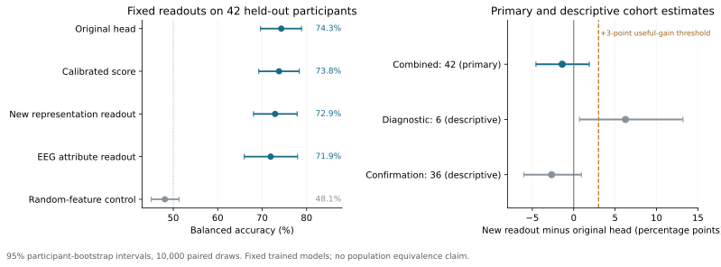

# 冻结 EEG 表示的旧分类头是否形成瓶颈？Builder 结果

在本次预先确定的42名测试被试上，新训练的线性表示读出没有优于旧分类头：balanced accuracy（BA，两类召回率的平均）从74.31%变为72.92%，差值为−1.39个百分点，95%区间为[−4.56, +1.88]。这没有支持“固定这份表示后，重新训练线性头可带来超过3个百分点的有用增益”。手工属性读出明显超过随机输入控制，但目前不能判定它与模型读出等价，也不能据此解释模型的预测机制。

右图蓝色为预定的42人主分析，灰色分组仅作描述。右侧虚线是事前设定的3个百分点有用增益边界；单看6人诊断分组会产生不同印象，因此不能据结果挑选报告人群。

这是 **Builder 执行的科学分析**，按[计算前协议](readout-bottleneck.md)报告。它不是受测 Agent 的成果、BrainPEC 原始实验复现或 ignition 证据。本文依据冻结结果及两类审计；控制者记录的首次结果读取在2026-11-01 20:48 UTC、审计完成后。后续[独立 Actor 对照](readout-method-transfer-results.md)的六份候选已完成独立数值审核，四份最终报告完成、两份因后端中断缺失；它们单独报告，不回填为本次 Builder 成果。

本次使用 EEGMMIDB 的72名新被试 S037–S108，与上一层实验的 S001–S036 不重叠。每人包含睁眼/闭眼各12个不重叠5秒窗口。S037–S072按固定种子314159分为训练、验证和诊断测试；S073–S108为预先指定的确认集。合并42人是预定主分析，不是另一个独立数据集。

| 分区 | 被试数 | 窗口数 | 用途 |
| --- | ---: | ---: | --- |
| 新训练集 | 24 | 576 | 拟合 B–E 的转换和参数 |
| 新验证集 | 6 | 144 | 按 BA 选择超参数 |
| 诊断测试集 | 6 | 144 | 描述性分组结果 |
| 确认集 S073–S108 | 36 | 864 | 描述性分组结果 |
| 两套测试合并 | 42 | 1,008 | 预定主分析；与前两行训练/验证分离 |

所有比较共用冻结 CBraMod 骨干。表示固定为对 token 求均值后的200维向量；没有测试保留 token 的读出或其他池化方式。旧头 A 的来源是 S001–S024训练、S025–S030选参；B–E 使用本次24名新训练被试。因此，A与C的差异同时可能受到训练人群、适配与训练程序影响，不能唯一归因于头的结构。旧头谱系依据本地私有证据 `.local/method-transfer/readout-head-lineage.md`，本次没有重新训练该旧头。

五种读出在同一测试分区上比较。B–E均只用训练集拟合转换与参数，从相同的四个正则化候选值中按验证 BA 选择，不在测试上调参。D使用12组手工属性展开的62列；E为62维独立高斯输入，维度与D匹配，与200维的C并非容量完全匹配。

| 读出 | 含义 | 合并42人 BA，95%区间 | AUROC | Log loss，越低越好 |
| --- | --- | ---: | ---: | ---: |
| A | 不变的旧头 | 74.31% [69.64, 78.87] | 0.8370 | 1.478 |
| B | 旧分数的正斜率校准与截距 | 73.81% [69.25, 78.37] | 0.8370 | 0.539 |
| C | 新训练的200维表示线性读出 | 72.92% [68.06, 77.88] | 0.8244 | 0.542 |
| D | 62列手工属性线性读出 | 71.92% [65.97, 77.98] | 0.8052 | 0.538 |
| E | 62维随机输入线性读出 | 48.12% [45.04, 51.29] | 0.4790 | 0.718 |

区间按整名被试进行10,000次配对 bootstrap；同一抽样用于所有读出，避免把一个人的窗口当成独立被试。这些区间反映固定读出下的被试抽样不确定性，不覆盖重新选择训练被试或重新训练的变化。以下差值单位为**百分点**。C−A为主对比；四个次要对比同时提供普通95%区间和 Bonferroni 修正的98.75%区间。

| 对比 | 差值 | 95%区间 | 次要对比修正区间 |
| --- | ---: | ---: | ---: |
| C−A：换新表示读出 | −1.39 | [−4.56, +1.88] | 不适用，主对比 |
| B−A：只校准旧分数 | −0.50 | [−1.29, +0.20] | [−1.59, +0.40] |
| D−A：手工属性对旧头 | −2.38 | [−7.84, +2.78] | [−9.23, +4.07] |
| D−C：手工属性对新表示读出 | −0.99 | [−5.65, +3.38] | [−6.94, +4.56] |
| D−E：手工属性对随机控制 | +23.81 | [+16.57, +31.15] | [+14.58, +33.04] |

**对原问题的回答有三个不同层次。** 首先，C−A没有达到预定的有用增益标准；这不证明旧头最优，也不证明完整表示中没有更多可用信息。其次，D−E的修正区间明确为正，支持这组手工属性在当前分区和任务下包含可用的预测信息。最后，D−A和D−C的修正区间都没有完整落入预定的±3个百分点等价范围，不能把“点估计接近”写成“表现等价”。也没有满足“D与A等价，同时C明显超过D”的联合条件，因此本次不支持“属性接近模型只是旧头较弱造成的假象”这一具体解释。

B保留了旧分数的排序，AUROC同为0.8370；其观察到的 log loss 从1.478降至0.539，但BA没有改善。这表明概率分数与零阈值分类表现需要分开报告。本协议没有为 log loss 差值计算推断区间，因此这里仅陈述本批测试数据上的变化，不宣称已证明总体概率校准收益。

两套测试的方向并不一致，不能只选取较有利的6人结果：

| 描述性分组 | A BA | B BA | C BA | D BA | E BA | C−A，95%区间，百分点 |
| --- | ---: | ---: | ---: | ---: | ---: | ---: |
| 诊断测试6人 | 83.33% | 84.03% | 89.58% | 93.06% | 47.22% | +6.25 [+0.69, +13.19] |
| 确认36人 | 72.80% | 72.11% | 70.14% | 68.40% | 48.26% | −2.66 [−6.02, +0.93] |

主判断仍以事先确定的合并42人为准。这次6名诊断被试也不同于上一层研究的6名测试被试；跨研究比较准确率不能证明模型或研究方法得到了改善。

协议中的 closure 类比值只作次要诊断。合并42人上，分子 D−E 为23.81个百分点；分母 A−E 为26.19个百分点、C−E为24.80个百分点。两个分母的95%区间下界分别为20.63、18.75个百分点，均通过预定的3个百分点弱分母检查。

| 诊断比值 | 点估计 | 95%区间 |
| --- | ---: | ---: |
| (D−E)/(A−E) | 0.909 | [0.697, 1.109] |
| (D−E)/(C−E) | 0.960 | [0.767, 1.146] |

这里的“通过分母检查”不等于估计精确：两个区间都很宽且包含1以上的值。比值未截断，也不是“手工属性因果解释了90.9%或96.0%的模型能力”。本实验没有对属性做预测依赖干预，没有回答 BrainPEC 原始 Q3 closure，也不能把可读出信息等同于模型实际使用的信息。6人诊断分组的旧头比值还有1次 bootstrap 分母为零，因此其比值区间按规则保留为不可用；该失败未被删去。

**冻结与审计支持的是本次计算的可核验性。** 准入于2026-11-01 20:26 UTC固定协议、输入、代码和旧头身份。准备阶段不拟合；B–E在训练/验证阶段选择后冻结。两套测试的逐行预测及身份先保存，再读取真值计算结果；冻结结果于20:29 UTC生成。随后分别进行缓存溯源复放和数值审计，没有重选模型或替换结果。

- 缓存审计核对144个原始 EDF 的官方哈希、全部1,728行的来源、HMAC ID、排列、真值、随机输入及公开/封存边界。它重放了全部1,008行测试数据，另加训练、验证各首名被试的24行，共1,056行。从原始记录到窗口、200维表示、62列属性和旧 logit 的受检值均精确相等，分类决定、排名和并列也一致。它复用了声明的机械适配器与原始前向 helper，不能作为独立生理有效性验证。
- 数值审计覆盖训练集标准化、全候选选参、保存参数的验证 BA、两套测试逐行预测，以及三组统计表、配对 bootstrap 和比值。预测数值检查之外保留了精确的分类决定、排名与并列检查。数值审计与原读出模块由同一作者编写，虽经另行审查，也不能称为完全独立实现或领域专家复核。
- 审计历史保留了失败：r01因输出目录的父目录尚未创建，在读取科学输入前失败；r02要求 Newton-CG 与原 L-BFGS 的参数相等，在未选中的 D、C=10 候选上有4/62个系数超出原容差。训练/验证决定未变，按声明的 L-BFGS 复算该候选及选中的 C=0.1 均精确复现。r03经重新审查后，以声明的 L-BFGS 做 C/D/E 参数复现验收，并保留 Newton-CG 的差异诊断；参数容差没有放宽，原拟合、选择和测试结果没有改变。这确实修订了审计的验收方式，不能把此前失败改记为通过。详情见本地私有证据 `.local/method-transfer/readout-fit-diagnosis.md`。

完整数字与执行身份保存在本地私有目录 `.local/method-transfer/` 的 `readout-results.json`、`readout-admission.json`、`readout-cache-audit.json` 和 `readout-numerical-audit.json`。这些文件包含完整路径与哈希，不随公共仓库发布；正文保留可公开的结果和审计边界。冻结记录和复放本身不构成对全部历史访问行为的绝对证明。

以下三项在冻结计算后补查。第一项进一步核对了正文§4.5和附录J；另外两项仅核对**官方摘要**。这些文献没有用于改动本次协议、选参或评分，说明的是更广的研究背景：

- [Beyond Accuracy，v2，§4.5与附录J](https://arxiv.org/html/2605.17562v2#A10)比较均值、注意力、展平和重复均值四种读出；重复均值对照与展平明确匹配输入维数、头结构和参数数目，作者报告展平在冻结骨干下的平均表现更高。本次只有固定均值池化，不能检验或否认保留token信息的潜力，也不应声称首次发现读出方式会影响对表示质量的判断。
- [Mechanistic Interpretability of EEG Foundation Models via Sparse Autoencoders，v3](https://arxiv.org/abs/2605.13930v3)的摘要区分可选择性操控、已编码但纠缠、未编码等状态，并比较目标与非目标效应。本次没有做这种干预选择性检验，不能从读出准确率推断预测依赖。
- [EEG-FM-Audit，v1](https://arxiv.org/abs/2605.26910v1)的摘要强调透明调参的监督基线及时间、空间、频谱神经生理探测，并报告在其所测条件下调优基线可匹敌或超过 FM。本次固定了读出的训练和选择机会，但没有复现该论文的任务、模型与探测体系。

本次证据限定于同一 EEGMMIDB 眼状态任务、一个冻结骨干、固定200维均值池化及线性读出。眼状态与 R01/R02记录顺序仍混杂；与旧36人不重叠也不能证明未进入骨干预训练。其他池化、非线性读出、跨模型/跨数据集迁移以及因果干预仍未检验；这些缺项不能由程序完成或本报告的正负结果补足。
